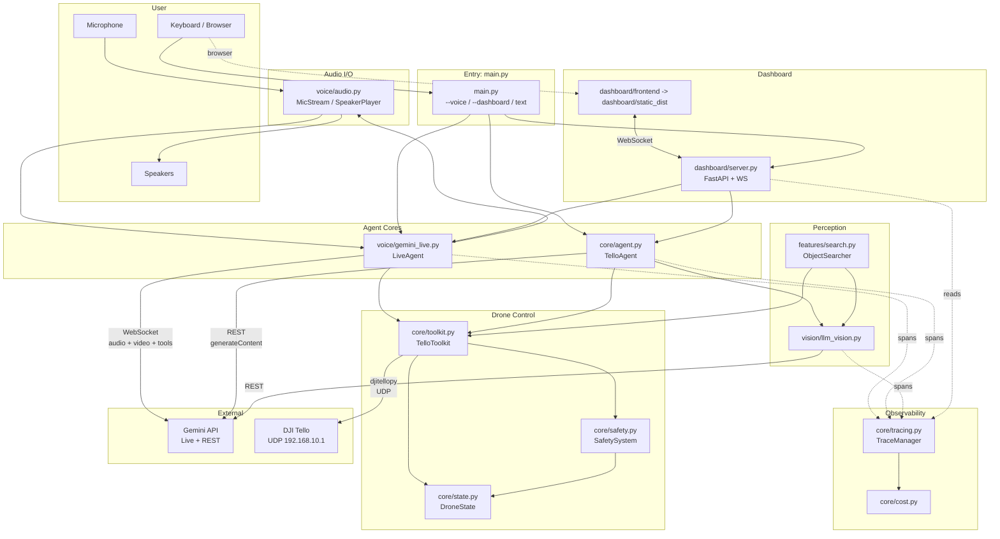
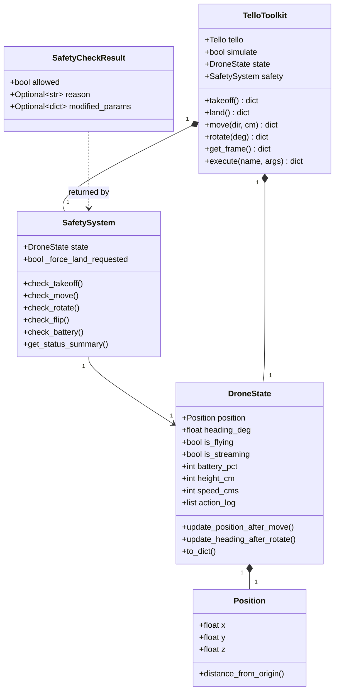

# Architecture

High-level view of how TelloAI is put together — what the modules are, what talks to what, and where external services enter the picture.

## System diagram



## Module inventory

```
tello-autonomous/
├── main.py                   # Entry point, argparse, mode selection
├── config.py                 # All constants, model strings, tool schemas
│
├── core/
│   ├── agent.py              # Legacy TelloAgent (Gemini 3.5 Flash REST loop)
│   ├── toolkit.py            # TelloToolkit — drone actions as typed functions
│   ├── safety.py             # Geofence, battery, altitude, param validation
│   ├── state.py              # DroneState — position, heading, flight status
│   ├── tracing.py            # TraceManager — spans, JSONL log, dashboard feed
│   └── cost.py               # Per-model token pricing
│
├── voice/
│   ├── gemini_live.py        # LiveAgent — persistent Live API WebSocket
│   └── audio.py              # MicStream + SpeakerPlayer (sounddevice)
│
├── vision/
│   └── llm_vision.py         # Frame → Gemini analysis (legacy path only)
│
├── features/
│   └── search.py             # ObjectSearcher state machine (not wired to agent)
│
├── dashboard/
│   ├── server.py             # FastAPI + WebSocket, routes to Live or Legacy
│   ├── frontend/             # React/Vite dashboard source
│   ├── static/               # Legacy dashboard UI fallback
│   └── static_dist/          # Generated React dashboard build
│
├── scripts/
│   └── network_check.py      # Verify dual-WiFi setup
│
└── tests/                    # pytest — toolkit, safety, state, tracing
```

## External services

| Service | Purpose | Transport | Where it enters |
|---|---|---|---|
| Gemini Live API | Real-time voice + vision + tool calling | WebSocket (persistent) | `voice/gemini_live.py` |
| Gemini generateContent | Text agent loop + standalone vision calls | REST over HTTPS | `core/agent.py`, `vision/llm_vision.py` |
| DJI Tello SDK | Drone commands + video stream | UDP (djitellopy) | `core/toolkit.py` |
| User microphone | Voice input | PortAudio via `sounddevice` | `voice/audio.py` |
| User speakers | Voice output | PortAudio via `sounddevice` | `voice/audio.py` |

## Runtime topology

TelloAI runs as a **single Python process** with concurrent async tasks, plus PortAudio-managed callback threads for audio I/O:

- **Main thread** — asyncio event loop hosting the agent, Live API WebSocket, and all REST calls
- **PortAudio input callback** — `MicStream._callback` fires every 20 ms with a fresh int16 PCM buffer and hands it to the event loop via `asyncio.run_coroutine_threadsafe` (`52:63:voice/audio.py`)
- **PortAudio output callback** — `SpeakerPlayer._callback` is pulled by the sound card at the device's tick rate; it drains a ring buffer fed by `play()` and pads silence on underrun (`133:162:voice/audio.py`). No hand-rolled thread — PortAudio owns the thread.
- **Dashboard only** — uvicorn's ASGI server manages the WebSocket/HTTP loop; the Live session runs inside uvicorn's lifespan context

For the dashboard mode, the React/Vite browser UI captures mic audio via the Web Audio API (`ScriptProcessorNode` downsamples browser audio to 16 kHz PCM) and streams binary WebSocket frames to the server.

## Data model



Key invariant: **every toolkit function runs through `SafetySystem` before touching the drone**. See `329:372:core/toolkit.py` for the dispatch table that enforces this.

## Why two agent paths?

| Concern | Live path | Legacy path |
|---|---|---|
| Model | `gemini-3.1-flash-live-preview` | `gemini-3.5-flash` |
| Session | One persistent WebSocket, stays open for whole session | New HTTPS POST per message |
| Vision | Drone video streamed at 1 FPS into the session | Separate `generateContent` call per frame |
| Voice | Native audio I/O with Aoede voice + input/output transcription | Text only |
| Tool calling | Synchronous — results returned via `send_tool_response()` | Multi-turn function calling via `generate_content` |
| Tracing | One trace per session, spans for tool calls only | One trace per user message, spans for every LLM + vision + tool call |

The legacy path is kept because it produces rich per-turn traces (with thought summaries, token counts, thumbnails) that the Live path can't match. Use it when debugging reasoning.

## Config as the source of truth

Every tunable constant lives in `config.py`. Subsystems import from it rather than hardcoding.

| Section | What's in it | Consumed by |
|---|---|---|
| `GEMINI_API_KEY` / `OPENAI_API_KEY` | Secrets from `.env` | all agent modules |
| `MODELS` | Model strings per role | `gemini_live.py`, `agent.py`, `llm_vision.py` |
| `SAFETY` | Geofence, battery, altitude, move limits | `safety.py` |
| `MOVEMENT` | Valid directions, scan step, explore step | `safety.py`, `features/search.py` |
| `VISION` | Frame dimensions, JPEG quality | `toolkit.py`, `llm_vision.py` |
| `LIVE` | Voice name, sample rates, video FPS, disabled tools | `voice/gemini_live.py`, `voice/audio.py` |
| `DASHBOARD` | Host, port | `main.py`, `dashboard/server.py` |
| `TRACING` | Log dir, terminal output, thumbnail size | `core/tracing.py` |
| `TOOL_SCHEMAS` | JSON schemas for each drone tool | `agent.py`, `gemini_live.py` |

## See also

- [workflow.md](./workflow.md) — how requests flow through this architecture
- [components.md](./components.md) — per-module details
- [user-flows.md](./user-flows.md) — what a user sees at runtime
- [safety.md](./safety.md) — safety layer specifics
