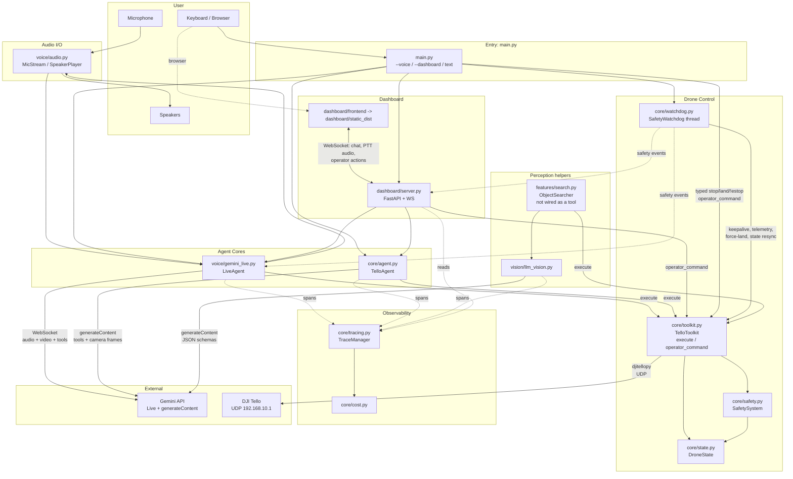
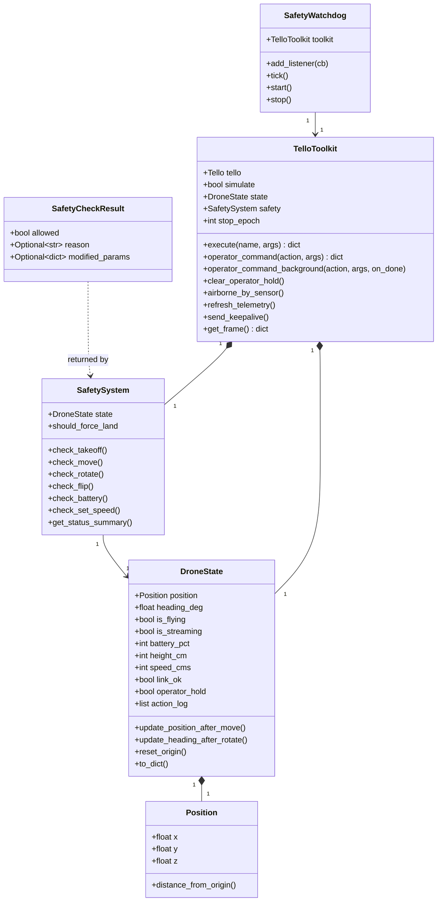

# Architecture

High-level view of how TelloAI is put together: what the modules are, what talks to what, and where external services and humans enter the picture.

## System diagram



## Module inventory

```
tello-autonomous/
├── main.py                   # Entry point, argparse, toolkit + watchdog, mode selection, land on exit
├── config.py                 # Models, thresholds, Live/dashboard settings, TOOL_SCHEMAS, OPERATOR_ONLY_ACTIONS
│
├── core/
│   ├── agent.py              # TelloAgent: gemini-3.8-flash function-calling loop + CLI REPL
│   ├── toolkit.py            # TelloToolkit: execute() for LLMs, operator_command() for humans
│   ├── safety.py             # Per-command checks: flying, battery, bounds, altitude, geofence
│   ├── watchdog.py           # SafetyWatchdog: battery, keepalive, link loss, state reconciliation, sim battery drain
│   ├── state.py              # DroneState, Position, project_move(), operator hold, link status
│   ├── tracing.py            # TraceManager: spans, JSONL log, dashboard feed
│   └── cost.py               # Per-model token pricing
│
├── voice/
│   ├── gemini_live.py        # LiveAgent: Live session, tools, stop words, reconnects
│   └── audio.py              # MicStream + SpeakerPlayer (sounddevice)
│
├── vision/
│   └── llm_vision.py         # One-shot frame analysis with structured JSON output
│
├── features/
│   └── search.py             # ObjectSearcher (safe, but not exposed as a tool)
│
├── dashboard/
│   ├── server.py             # FastAPI + WebSocket, Live/legacy routing, operator controls, access control
│   ├── frontend/             # React/Vite dashboard source
│   └── static_dist/          # Generated build (gitignored); "/" returns 503 if missing
│
├── scripts/
│   └── network_check.py      # Verify dual-network setup
│
└── tests/                    # pytest: safety core, toolkit, agent, Live, server, vision, search, tracing
```

## External services

| Service | Purpose | Transport | Where it enters |
|---|---|---|---|
| Gemini Live API (`gemini-3.8-live`) | Real-time voice + vision + tool calling | WebSocket (persistent, resumed across connections) | `voice/gemini_live.py` |
| Gemini generateContent (`gemini-3.8-flash`, `gemini-3.1-flash-lite`) | Text agent loop, one-shot vision helpers | HTTPS | `core/agent.py`, `vision/llm_vision.py` |
| DJI Tello SDK | Drone commands, state packets, video stream | UDP (djitellopy) | `core/toolkit.py` |
| User microphone / speakers | Voice I/O on the host | PortAudio via `sounddevice` | `voice/audio.py` |
| Browser microphone | Dashboard push-to-talk | `getUserMedia` → binary WebSocket frames | `dashboard/frontend/src/lib/audio.ts` |

## Runtime topology

TelloAI runs as a **single Python process**:

- **Main thread**: asyncio event loop hosting the agent or Live session (and, in dashboard mode, uvicorn's ASGI loop). The Live session starts and stops inside the FastAPI `lifespan` context.
- **Worker threads** (`asyncio.to_thread` / default executor): every toolkit call from async code. Drone I/O blocks (UDP round-trips, multi-second moves), so it never runs on the event loop.
- **Dashboard operator pools** (`dashboard/server.py`): STOP, E-STOP and Resume run on `_INSTANT_POOL`, Land on `_LAND_POOL`. Neither is shared with other work, so a STOP is never starved by Land presses or AI tool calls.
- **Operator command threads** (`TelloToolkit.operator_command_background`): one daemon thread per typed CLI operator command, spoken stop word and watchdog force-land, so `!estop` never waits behind a `land`.
- **Safety watchdog thread** (`core/watchdog.py`, daemon, every 1 s): refreshes telemetry, checks link and battery, reconciles `is_flying` with the height sensor, sends keepalives, drains the simulated battery. Force-land runs on its own operator thread so ticks continue. Listeners run on the watchdog thread; the dashboard and voice mode hop back to the event loop with `loop.call_soon_threadsafe`.
- **Text-mode input thread** (`core/agent.py` → `_read_lines`): reads typed lines so `stop` / `land` / `!estop` run immediately, even while the agent is mid-request.
- **PortAudio callback threads**: `MicStream._callback` hands 20 ms PCM blocks to the event loop; `SpeakerPlayer._callback` drains a ring buffer with a 200 ms prebuffer.
- **djitellopy background threads**: state-packet receiver and video frame reader.

All drone commands share one re-entrant lock (`_cmd_lock`, a `threading.RLock`) in `TelloToolkit`, because the Tello answers over a single UDP socket and djitellopy hands out replies in arrival order without matching them to commands. For motion, the safety check, send and state update all run under the lock, so concurrent moves can't breach the geofence or altitude limits. Operator stop/land/emergency send a raw command without waiting for the lock so they work while a long move is in flight; they bump `stop_epoch` (cancelling queued commands) and set a settle window, so the next locked command waits out the interrupted motion and drains stray replies first. An operator land then takes the lock itself and holds it through the land.

In dashboard mode, the browser captures mic audio with the Web Audio API (`ScriptProcessorNode`, 4096-sample buffers downsampled to 16 kHz PCM16) only while the talk button is held, and streams binary WebSocket frames. Live audio replies play on the **host machine's** speakers, not in the browser.

## Data model



Key invariants:

- **Every flight command goes through `SafetySystem` before touching the drone**, whether it came from an LLM (`execute`) or a human (`operator_command` → `takeoff` / `move` / `rotate` / `flip`). Only stop-type actions (hover, land, emergency stop) skip the checks, because they must always work.
- **LLMs can only reach `execute()`**, which accepts only `TOOL_SCHEMAS` names. `emergency_stop`, `flip` and `hover` are operator-only.
- **Nothing queued flies after a stop.** AI and manual commands capture `stop_epoch` when requested; if an operator stop happens while they wait for the drone (including the settle wait), they are cancelled instead of sent.
- **`is_flying` follows the height sensor on a real drone.** Land must be sensor-confirmed, an uncertain takeoff is decided by a settled height reading, and the watchdog resyncs any lasting disagreement.

## Why two agent paths?

| Concern | Live path | Text agent (legacy path) |
|---|---|---|
| Model | `gemini-3.8-live` | `gemini-3.8-flash` (thinking `medium`) |
| Session | One logical session; compression + resumption across ~10-minute connections | New `generateContent` request per loop step |
| Vision | Drone video into the session (≤1 FPS, rationed in push-to-talk mode) | `get_frame` JPEG returned inside the function response |
| Voice | Native audio I/O, Aoede voice, input/output transcription | Text only |
| Tool calling | BLOCKING tools, each run as a task; cancellable mid-motion | Sequential function calling, up to 15 model calls per message |
| Tools exposed | 9 (no `get_frame`, `stream_on`, `stream_off`) | All 12 `TOOL_SCHEMAS` tools |
| Tracing | One trace per session, `tool_call` spans only | One trace per message: `llm_call` (tokens, cost, thought summary) + `tool_call` spans with thumbnails |

The text agent is kept because it produces rich per-turn traces that the Live path can't match. Use it when debugging reasoning.

## Config as the source of truth

Every tunable constant lives in `config.py`. Subsystems import from it rather than hardcoding.

| Section | What's in it | Consumed by |
|---|---|---|
| `GEMINI_API_KEY` / `OPENAI_API_KEY` | Secrets from `.env` | agent, Live, vision modules |
| `MODELS` | Model ID per role (`live`, `vision_reasoning`, `vision_quick`, `vision_spatial`) | `gemini_live.py`, `agent.py`, `llm_vision.py` |
| `THINKING` | Thinking level per task (`reasoning`, `quick`, `spatial`) | `agent.py`, `llm_vision.py` |
| `SAFETY` | Limits, battery thresholds, watchdog/keepalive/link timings, operator-land wait, settle/land-confirm/force-land-retry timings | `safety.py`, `toolkit.py`, `watchdog.py`, `features/search.py` |
| `SIMULATION` | Takeoff height, battery drain rate | `toolkit.py` |
| `MOVEMENT` | Valid directions, scan step, explore step | `safety.py`, `features/search.py` |
| `VISION` | Frame size, JPEG quality, media resolution | `toolkit.py`, `agent.py`, `llm_vision.py` |
| `LIVE` | Voice, sample rates, video limits, VAD, turn coverage, compression, reconnect, disabled tools | `voice/gemini_live.py`, `voice/audio.py` |
| `DASHBOARD` | Host (default `127.0.0.1`), port, token, extra origins | `main.py`, `dashboard/server.py` |
| `TRACING` | Log dir/file, terminal output, thumbnail size | `core/tracing.py`, `llm_vision.py` |
| `TOOL_SCHEMAS` | JSON schemas for the 12 LLM tools | `toolkit.py`, `agent.py`, `gemini_live.py` |
| `OPERATOR_ONLY_ACTIONS` | `emergency_stop`, `flip`, `hover` | `toolkit.py` (import-time assertion) |

## See also

- [workflow.md](./workflow.md): how requests flow through this architecture
- [components.md](./components.md): per-module details
- [user-flows.md](./user-flows.md): what a user sees at runtime
- [safety.md](./safety.md): safety layer specifics
