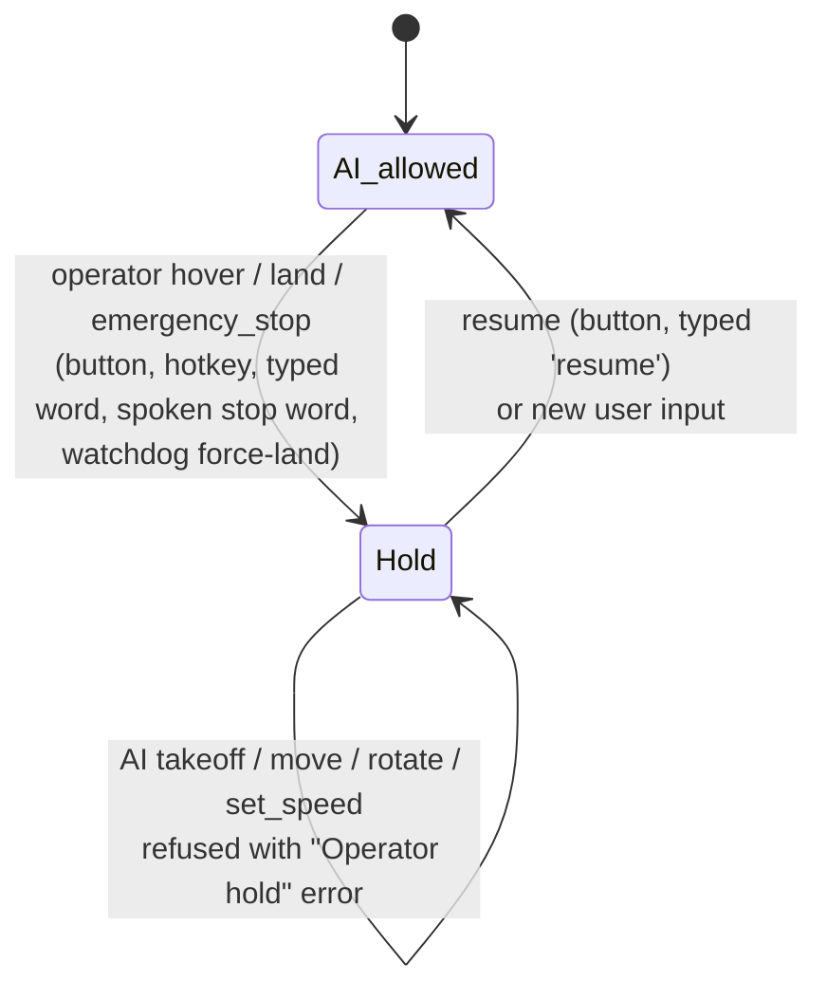
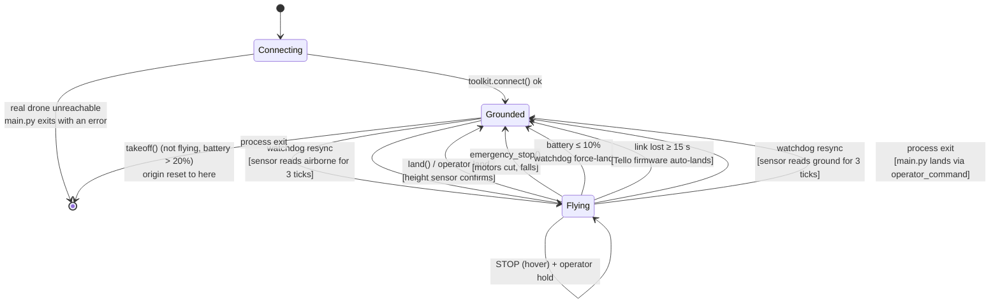

# Safety System

Reference for the safety layer: every limit, every check, the operator controls, the watchdog, and how the flight lifecycle interacts with them.

## Principle: software and the operator are the only safeguards

A DJI Tello has **no obstacle sensors, no GPS and no collision avoidance**. It happily flies into a wall if told to. Everything that keeps it from crashing is either enforced in Python before the UDP command goes out, or done by a human through the operator controls.

Three layers:

1. **Per-command checks** (`core/safety.py`, `core/toolkit.py`): every flight command is validated, clamped or refused before it reaches the drone.
2. **Continuous checks** (`core/watchdog.py`): a background thread watches battery and link, and keeps the drone from auto-landing while idle.
3. **Operator controls** (`TelloToolkit.operator_command`): humans can stop, land or cut the motors at any time without the LLM, and doing so blocks AI motion until the user speaks again.

The LLMs are also prompted to behave safely (`SYSTEM_PROMPT` in `core/agent.py`, `VOICE_SYSTEM_PROMPT` in `voice/gemini_live.py`), but those are hints. The code is authoritative.

---

## Thresholds

All from `config.py` (`SAFETY`). Every value is enforced in code.

| Constant | Value | What it enforces |
|---|---|---|
| `geofence_radius_cm` | `800` | A move is refused if its projected end point is more than 8 m (horizontal) from the latest takeoff point. |
| `max_altitude_cm` | `200` | Ceiling. `up` moves are clamped to the remaining headroom, refused if less than 20 cm is left. |
| `min_safe_altitude_cm` | `20` | Floor while flying. `down` moves are clamped, refused if less than 20 cm is left. |
| `battery_warn_pct` | `20` | Takeoff refused at or below. Watchdog warns once per crossing. Motion results carry a `WARNING`. |
| `battery_critical_pct` | `10` | Commands refused; the watchdog force-lands, and `execute()` lands instead of running any non-`land` tool. |
| `max_single_move_cm` | `100` | Longer moves are clamped to 100 cm and the result includes a note to look before moving again. |
| `min_move_cm` | `20` | Tello SDK minimum; shorter moves are clamped up. |
| `max_rotate_deg` | `360` | Rotation clamped to ±360°. |
| `flip_min_battery_pct` | `50` | Flip (operator-only) needs more than this. |
| `default_speed_cms` | `30` | Sent to the drone on connect. `set_speed` is clamped to 10–100 cm/s. |
| `watchdog_interval_s` | `1.0` | Watchdog tick. |
| `keepalive_interval_s` | `8` | Idle time in flight before a keepalive (the Tello auto-lands after 15 s without a command). |
| `connection_timeout_s` | `5` | No state packet for this long marks the link lost. |
| `operator_land_lock_timeout_s` | `25.0` | How long an operator/watchdog land waits for the command lock (covers the longest motion timeout). After that a raw `land` is sent and reported as unconfirmed. |
| `abort_settle_s` | `0.7` | After a raw stop/land/E-STOP, the next command waits this long past the end of the interrupted motion, then drains stray replies. |
| `stationary_confirm_s` | `0.4` | The settle wait ends early once the state packet shows zero velocity and steady yaw for this long. |
| `sensor_settle_s` | `1.5` | Height re-read window after a takeoff whose reply was an error or interrupted. |
| `land_confirm_s` | `6.0` | A land "ok" must be confirmed by the height sensor within this time. |
| `priority_land_attempts` | `3` | Operator/watchdog land attempts while the drone stays airborne. |
| `force_land_retry_s` | `5.0` | The watchdog retries a failed force-land this often. |
| `height_airborne_cm` | `10` | A height-sensor reading above this means airborne. |

---

## Check-by-check

### `check_takeoff`

| Rule | Result |
|---|---|
| Already flying | Reject |
| Battery ≤10 % | Reject (critical) |
| Battery ≤20 % | Reject ("too low to take off") |

### `check_move`

Order of checks:

1. Direction is in `MOVEMENT["valid_directions"]`, else reject
2. Drone must be flying, else reject
3. `check_battery`: reject at ≤10 %, carry a warning at ≤20 %
4. Clamp `cm` into `[20, 100]`
5. `up`: clamp to the headroom below 200 cm; reject if under 20 cm
6. `down`: clamp to the room above 20 cm; reject if under 20 cm
7. Project the new x/y with `project_move()` and the current heading; reject if beyond the geofence

Clamped values come back in `modified_params` and are applied; the result notes the requested vs actual distance. Rejections return the exact reason so the LLM can re-plan.

### `check_rotate`

Requires flying and a non-critical battery. `abs(degrees) > 360` is clamped to ±360.

### `check_flip`

| Rule | Result |
|---|---|
| Direction not in `MOVEMENT["valid_flip_directions"]` | Reject |
| Not flying | Reject |
| Battery ≤50 % | Reject |

Flips are **operator-only**: no LLM can request one.

### `check_battery`

| Condition | Result |
|---|---|
| `battery_pct ≤ 10` | Reject with a `CRITICAL` reason |
| `battery_pct ≤ 20` | Allow, `reason` carries a `WARNING` |
| Otherwise | Allow |

### `check_set_speed`

Clamps to `[10, 100]` cm/s. Always allowed.

---

## LLM vs operator entry points

| | `toolkit.execute(name, args)` | `toolkit.operator_command(action, args)` |
|---|---|---|
| Called by | Text agent, Live agent, `features/search.py` | Dashboard buttons/hotkeys, typed CLI/chat words, spoken stop words, watchdog, shutdown |
| Accepts | Only `TOOL_SCHEMAS` names (takeoff, land, move, rotate, get_frame, get_battery, get_height, get_temperature, get_speed, set_speed, stream_on, stream_off) | hover, land, emergency_stop, resume, takeoff, move, rotate, flip |
| Before dispatch | Captures `stop_epoch`; refreshes telemetry; force-lands on critical battery; refuses motion during an operator hold | Stop actions bump `stop_epoch` and set the hold; manual motion captures `stop_epoch`, is single-flight ("busy" error), and still runs its safety checks |

`emergency_stop`, `flip` and `hover` (`config.OPERATOR_ONLY_ACTIONS`) are absent from `TOOL_SCHEMAS`, and `core/toolkit.py` asserts at import that they stay that way: a misheard word must never cut the motors or flip the drone indoors.

### Operator hold



"New user input" means: a text-agent message, a dashboard chat command, a push-to-talk press, typed text in voice mode, or (open mic only) a new spoken utterance that isn't itself a stop word. Watchdog safety notices sent to the Live model do **not** clear the hold. Read-only tools and `land` stay available during a hold.

The agent clears the hold when it starts the new turn; the dashboard server never clears it itself, so an AI turn still running from before the STOP keeps being refused. Exceptions that keep the hold:

- **Text agent**: `process_message` records `stop_epoch` when the message arrives. If a STOP happened after that (the message waited behind a running turn), the hold stays and the model is told the operator stopped the drone after the message was sent.
- **Live**: `send_text(release_hold=...)` releases the hold only if the message can be delivered. If the link is down it is not released; if the send fails it is restored.
- **Observe** (dashboard): sends `keep_hold: true`. It is a camera-only request and never lifts a STOP.

### Stop epoch: cancelling queued commands

Every operator hover/land/E-STOP, and every `toolkit.hover()` (for example a Live barge-in abort), increments `toolkit.stop_epoch`. AI commands (`execute()`) and manual operator commands capture the epoch when they are requested. Before sending, and repeatedly during the settle wait, they compare it: if a stop happened while they waited for the drone, they are cancelled (`OperatorStopped`, returned as an error result) instead of flown. This covers takeoff, move, rotate, set_speed and flip; `land` is never cancelled.

### Command lock and settle window (real drone)

- `_cmd_lock` is a re-entrant `threading.RLock`. For takeoff, move, rotate and flip, the epoch check, safety check, send and `DroneState` update all run under it, so two concurrent moves can't both pass the geofence/altitude check against a position that doesn't include the other.
- Raw stop/land/emergency are sent without waiting for the lock. Their replies, and the reply of the motion they interrupt, still arrive on djitellopy's shared reply queue, which hands out replies in arrival order without matching them to commands. So each raw send sets a **settle window**: the next locked command waits until `abort_settle_s` (0.7 s) past the interrupted motion's deadline, then drains the queue. The wait is cancellable by another STOP, sends `rc 0 0 0 0` keepalives so the Tello's 15 s timer stays fed, and ends early once velocity and yaw show the drone stationary for `stationary_confirm_s` (0.4 s).
- Interrupted moves and rotations return `success: false` with "interrupted by an operator stop". A move is recorded at full length, so the position estimate may be off by up to the move length; heading is re-read from the IMU.

### Stop, land and emergency stop on a real drone

| Action | What is sent | Notes |
|---|---|---|
| STOP (`hover`) | Raw SDK `stop` without waiting for the command lock, **only if a motion is in flight**; nothing when idle (the Tello already hovers) | Aborts an in-flight move **only on firmware that supports `stop`** (SDK 2.0+). Older or plain-Tello firmware may refuse it and finish the move. Always bumps `stop_epoch`, so queued commands are cancelled. |
| Land (`_priority_land`) | Raw `stop` if a motion is in flight, then take the command lock (up to 25 s) and **hold it through** a normal `land`, retried up to 3 times while the drone stays airborne | Single-flight: a second Land press (or a watchdog retry) while one is running gets "A land is already in progress". The Tello rejects `land` mid-move, so waiting beats interrupting. If the lock never frees, a raw `land` is sent and reported as **unconfirmed**; the drone stays marked as flying. |
| E-STOP (`emergency_stop`) | Raw `emergency` | Motors cut, the drone **falls**. The only guaranteed instant interrupt. Marks the drone landed (also during a takeoff). The dashboard requires a second confirm click within 5 s. |

Every `land` (AI, operator or watchdog) trusts the height sensor, not the reply: an "ok" counts only once the sensor reads ground within `land_confirm_s` (6 s), because a late "ok" from an interrupted move could be read as the land's. A lost reply gets one retry; an error reply while the sensor already reads ground counts as landed. A takeoff whose reply was an error or interrupted is decided by a settled height reading (`sensor_settle_s`); an E-STOP during takeoff means not flying.

---

## Safety watchdog

`SafetyWatchdog` (`core/watchdog.py`) runs on its own daemon thread, every second, in every mode.

| Rule | Behaviour |
|---|---|
| Battery ≤20 % | One `warning` (`battery_low`) per crossing |
| Battery ≤10 % while flying | One `critical` (`battery_critical`) event per episode, then `operator_command_background("land")` on its own thread (sets the operator hold), so link and battery checks keep ticking during a slow landing. A failed landing emits `force_land_failed` once and is retried every 5 s (`force_land_retry_s`). The episode re-arms after landing or once the battery reads above 10 %. |
| No state packet for >5 s | `link_ok = False`, one `critical` (`link_lost`) event; `info` (`link_restored`) when packets return |
| Height sensor disagrees with `is_flying` for 3 consecutive ticks while no command or motion is running | State reconciliation. Sensor airborne but marked landed: marked flying again (origin kept), so keepalive and battery protection resume; `critical` `state_resync_airborne`. Sensor on the ground but marked flying: marked landed; `warning` `state_resync_landed`. Real drone only. |
| Flying, link OK, ≥8 s since the last command | `rc 0 0 0 0` keepalive (works on all firmware, no reply), skipped if another command holds the lock |
| Simulation | Battery drains at 7.5 %/min while flying (about 13 minutes of flight) |

Where events go:

- **Text / voice CLI**: printed as `[SAFETY WARNING] ...`. In voice mode, warnings and critical events are also sent to the model with `send_system_notice` so it tells the user and doesn't start new motion.
- **Dashboard**: broadcast as `{"type": "safety", ...}` (toasts; critical ones stay until dismissed), followed by a state update (LINK LOST badge and banner), and forwarded to the Live model.

---

## Flight lifecycle



### Transitions explained

- **Connecting**: in simulation, `connect()` always succeeds. With a real drone, a failed connect exits the process. There is **no silent fallback to simulation**.
- **Grounded → Flying**: only through `takeoff()` after `check_takeoff` passes. Each takeoff resets the origin, so the geofence and dead reckoning start from the new spot.
- **Flying → Flying**: allowed only if the relevant `check_*` passes. On rejection the call returns `{success: False, error: reason}` and the state doesn't change.
- **Flying → Grounded (land)**: on a real drone, only once the height sensor reads ground. A land that the sensor doesn't confirm, or an unconfirmed raw `land` after the 25 s lock wait, returns an error and the drone stays marked as flying.
- **Watchdog resync**: a safety net for any path that leaves `is_flying` wrong (a misread reply, an interrupted takeoff, a drone that auto-landed). It acts only when no command holds the lock and no motion is in flight.
- **Force-land**: the watchdog lands at ≤10 %. Independently, `execute()` refuses any non-`land` tool while `should_force_land` is true and lands instead. A later reading above 10 % lets commands through again, but takeoff stays refused until the battery is above 20 %.
- **Process exit**: `main.py` lands with `operator_command("land")` in its `finally` block on normal exit and Ctrl+C. The text REPL and voice mode also land on `quit` / exit.

---

## What the LLM is told

Every text-agent message is prefixed with a status line from `SafetySystem.get_status_summary()`:

```
[Drone Status: Battery: 42% | Distance from home: 120/800cm | Altitude: 85/200cm | Heading: 90° | Flying: True]
```

It ends with `| OPERATOR HOLD: ...` during a hold and `| LINK LOST` without telemetry. If the message itself released a hold, a note says so. Live tool responses carry a compact drone-state summary (flying, battery, height, heading, distance from home, operator hold) so the model never relies on facts evicted by context compression.

Both system prompts say: moves are capped at 100 cm (look at the camera between moves), stay within 8 m and 200 cm, land below 20 % battery, confirm risky moves, treat "Operator hold" errors as final until the user speaks again, and send emergency-stop or flip requests to the operator controls.

---

## Failure modes and how the system responds

| Failure | Detection | Response |
|---|---|---|
| Battery drops to 10 % mid-flight | Watchdog (every 1 s) and `execute()` | Force-land on its own thread, retried every 5 s until it succeeds; the operator hold is set; one alert per episode in the CLI/dashboard and to the Live model |
| Move would exit the geofence | `check_move` projection | Refused; the LLM gets current and projected distances |
| Move would exceed the ceiling or floor | `check_move` up/down branches | Clamped, or refused at the limit |
| Move longer than 100 cm | `check_move` clamp | Clamped to 100 cm with a note |
| Motion while landed | `_require_flying` | Refused |
| AI tries to move after an operator STOP | `execute()` operator-hold check | Refused with an "Operator hold" error |
| Commands queued behind a move when STOP is pressed | `stop_epoch` changed since they were requested | Cancelled before sending (also during the settle wait) |
| Two moves race each other | Check + send + state update under one `RLock` | The second one is checked against the position after the first |
| Rapid manual pad presses | `_manual_gate` | Second press refused with a "busy" error, not queued |
| Drone telemetry stops | Watchdog link check | LINK LOST event, badge and banner; the Tello lands itself after 15 s without commands |
| djitellopy reply timeout on a move | `Tello(retry_count=1)` + motion-sized timeout | No blind re-send, so no double move |
| Stray reply from a raw stop/land/E-STOP or the motion it interrupted | Settle window, then `_drain_responses()` before the next command | Not mistaken for the next command's answer |
| Land "ok" that belonged to another command | Height-sensor confirmation | Not reported as landed while the sensor still reads airborne |
| Land rejected because the Tello is busy | `_priority_land` holds the lock | Retried up to 3 times while airborne; raw `land` after 25 s is reported as unconfirmed |
| Repeated Land presses | `_land_gate` | Single-flight; extra presses report "already in progress" |
| `is_flying` wrong after a misread reply or auto-land | Watchdog state reconciliation | Resynced after 3 ticks with nothing commanding the drone; alert sent |
| Ctrl+C while flying | `main.py` `finally` block | Operator land |
| Gemini API transient error (text agent, vision) | HTTP retry (`config.GEMINI_HTTP_RETRY`) | Up to 4 attempts with backoff, then the turn is rolled back and the error returned as the reply |
| Live connection drops or gets `go_away` | `LiveAgent._supervise` | Resume with the latest handle; backoff up to 5 attempts; then "Voice link failed — restart required" |
| User barges in during a Live move | `tool_call_cancellation` | Queued calls cancelled; a running takeoff/move/rotate is aborted with `hover()`, which also cancels toolkit commands still waiting |
| Live connection drops with tool calls pending | `LiveAgent._orphan_tool_calls` | Calls not yet started are cancelled; running ones finish; one summary notice (what ran, what didn't, current status) goes to the model after reconnect |
| Real drone unreachable at startup | `create_toolkit` | Process exits with an error |

### Known gaps

- **No field validation yet.** All of the above is tested in simulation and against a `FakeTello`, not on a real drone.
- **`stop` may be refused** by older or plain-Tello firmware. E-STOP is the only guaranteed instant interrupt. Test a raw `stop` on the ground before relying on STOP in flight.
- **Settle and land waits** can take a few seconds on firmware without `stop`: the interrupted move runs to completion before the next command or the land goes out (land waits up to 25 s for the lock).
- **Yaw sign**: the IMU yaw direction self-calibrates on the first rotation of 20° or more. Before that, dead-reckoned x/y (and so the geofence) may be mirrored. Verify on the first flight.
- **Live `turn_coverage`** with real video (how frames sent outside speech are counted) needs checking on the first real session.
- **Dead reckoning drifts**: the geofence is a soft boundary. Altitude and heading come from sensors; x/y do not.
- **No obstacle detection in code**: "look before you move" relies on the model reading the camera. `check_path_clear` exists but is only used by the unwired object search.
- **Firmware auto-land thresholds** (low battery) are community-reported, not documented; the 10 % force-land sits close to them.
- **Take-off surface**: there is no check that the drone sits on a flat, clear surface.

---

## Extending the safety system

To add a new per-command check:

1. Add a method on `SafetySystem` returning `SafetyCheckResult`
2. Call it from the matching `TelloToolkit` method, inside its `with self._cmd_lock:` block and before the drone call, so the check and the state update stay atomic
3. Put any new threshold in `config.SAFETY`
4. Add tests to `tests/test_safety_core.py` (it has fixtures for simulated, flying and `FakeTello` toolkits)

For a continuous rule (something that must hold even when nobody sends a command), add it to `SafetyWatchdog.tick()` and emit an event with `_emit(level, code, message)` so the CLI, dashboard and Live model all hear about it.

### Example: no-fly-in-dark mode

```python
def check_lighting(self, avg_brightness: int) -> SafetyCheckResult:
    if avg_brightness < SAFETY.get("min_brightness", 40):
        return SafetyCheckResult(
            allowed=False,
            reason="Too dark to fly safely: the vision model can't make out obstacles.",
        )
    return SafetyCheckResult(allowed=True)
```

Hook this into `move()` via a frame sample before the drone call.

## See also

- [workflow.md §4](./workflow.md#4-tool-execution-inside-the-toolkit): how the safety layer fits into tool execution
- [components.md](./components.md#coresafetypy--safetysystem): safety module reference
- [architecture.md](./architecture.md#data-model): where `SafetySystem` sits in the class graph
