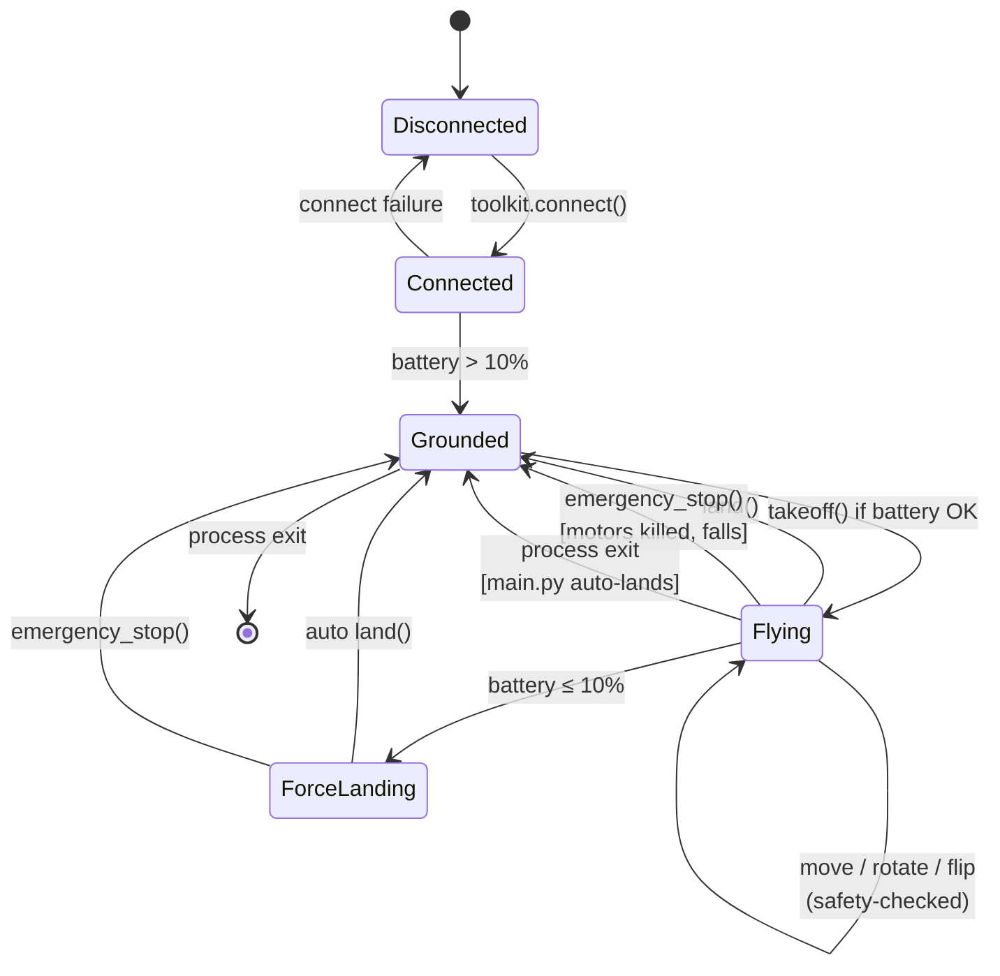
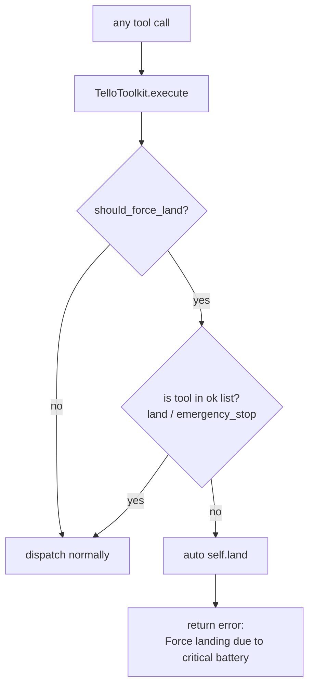

# Safety System

Reference for the safety layer. All thresholds, all checks, and how the drone's flight lifecycle interacts with them.

## Principle: software is the only safeguard

A DJI Tello has **no obstacle sensors, no GPS, no IMU fusion for position, and no collision avoidance**. The drone happily flies into a wall if you tell it to. Everything in this system that keeps it from crashing is enforced in Python before the UDP command goes out.

Accordingly:

- `SafetySystem` is called on every action
- `TelloToolkit` refuses to dispatch if `check_*` returns `allowed=False`
- A "force land" flag in `SafetySystem` short-circuits further commands once critical battery is seen

The LLM is also prompted to behave safely (`VOICE_SYSTEM_PROMPT` in `voice/gemini_live.py`, `SYSTEM_PROMPT` in `core/agent.py`), but those are best-effort hints. Only the `SafetySystem` is authoritative.

---

## Thresholds

All from `config.py` `41:53`. Changing a value here changes it everywhere.

| Constant | Value | What it enforces |
|---|---|---|
| `SAFETY["geofence_radius_cm"]` | `800` | Max 8 m from takeoff point. Move is rejected if projected XY distance would exceed it. |
| `SAFETY["max_altitude_cm"]` | `200` | Hard ceiling. `up` moves are clamped or rejected. |
| `SAFETY["battery_warn_pct"]` | `20` | Warning surfaced in drone-state context; agent is told to land. |
| `SAFETY["battery_critical_pct"]` | `10` | Force-land flag set; only `land` / `emergency_stop` accepted after. |
| `SAFETY["battery_check_interval_s"]` | `5` | Reference only; actual battery polling is lazy. |
| `SAFETY["max_single_move_cm"]` | `100` | Agent is *prompted* to call `get_frame()` after this much movement. Not hard-enforced. |
| `SAFETY["min_move_cm"]` | `20` | djitellopy's minimum. Moves below this are clamped up. |
| `SAFETY["max_move_cm"]` | `500` | djitellopy's maximum. Moves above this are clamped down. |
| `SAFETY["max_rotate_deg"]` | `360` | Rotation magnitude ceiling. |
| `SAFETY["connection_timeout_s"]` | `5` | Not yet wired — reserved for a watchdog. |
| `SAFETY["default_speed_cms"]` | `30` | Starting indoor speed. |

---

## Check-by-check

### `check_takeoff` (`core/safety.py` `123:132`)

| Rule | Reject or modify |
|---|---|
| Already flying (`state.is_flying`) | Reject |
| Battery ≤ `battery_critical_pct` | Reject, set force-land |
| Battery ≤ `battery_warn_pct` | Allow with warning in `reason` |

### `check_move` (`39:106`)

Order of checks:

1. Direction is in `MOVEMENT["valid_directions"]`, else reject
2. Clamp `cm` into `[min_move_cm, max_move_cm]`
3. If `direction=="up"`: project altitude; if > cap, clamp or reject
4. If `direction=="down"`: project altitude; don't let it go below 20 cm
5. Project new XY position using current heading; reject if beyond geofence
6. Run `check_battery`

Clamped values come back in `modified_params` and get applied. Rejected moves return the exact reason so the LLM can reason about it.

### `check_rotate` (`108:121`)

| Rule | Action |
|---|---|
| `abs(degrees) > 360` | Clamp to ±360 and return `modified_params` |
| Otherwise | Allow |

Battery check still runs — a drained drone can't safely yaw either.

### `check_flip` (`134:146`)

| Rule | Action |
|---|---|
| Direction not in `MOVEMENT["valid_flip_directions"]` | Reject |
| `battery_pct < 50` | Reject |
| Otherwise | Allow |

Flips spike current draw and browning out mid-flip = uncontrolled descent. The 50 % floor is non-negotiable.

### `check_battery` (`148:160`)

Produces one of three results:

| Condition | Result |
|---|---|
| `battery_pct ≤ 10` | Reject + set `_force_land_requested = True` |
| `battery_pct ≤ 20` | Allow, but `reason` carries a WARNING string |
| Otherwise | Allow |

Once `_force_land_requested` is `True`, `TelloToolkit.execute` (`core/toolkit.py` `342:344`) refuses **everything except `land` and `emergency_stop`** until the process restarts.

### `check_set_speed` (`162:167`)

Clamps to `[10, 100]` cm/s. Always returns `allowed=True`.

---

## Flight lifecycle



### Transitions explained

- **Disconnected → Connected** — `TelloToolkit.connect()`. If `djitellopy.Tello.connect()` raises, the toolkit falls back to simulation (stays "connected" but doesn't touch hardware).
- **Connected → Grounded** — implicit. The toolkit trusts the drone is on the ground until told otherwise.
- **Grounded → Flying** — only through `takeoff()` after `check_takeoff` passes.
- **Flying → Flying** — allowed only if the relevant `check_*` passes. On rejection, the move returns `{success: False, error: reason}` and the state doesn't change.
- **Flying → Grounded via `emergency_stop`** — `tello.emergency()` cuts motor PWM. The drone free-falls from current altitude. Only use when a hard crash is already happening or imminent.
- **Flying → ForceLanding** — set by `check_battery` seeing ≤10 %. Next call through `execute` triggers auto-`land()`.
- **Process exit from Flying** — `main.py` `226:232` runs `toolkit.land()` in the `finally` block on both normal exit and KeyboardInterrupt.

---

## Force-land flag



The flag is **sticky** — once set by `check_battery`, only a process restart clears it. This is intentional: once a battery has dropped below 10 %, you don't want the LLM to talk itself into another move just because the next reading bounced to 11 %.

See `core/toolkit.py` `342:344` and `core/safety.py` `148:155`.

---

## What the LLM is told

Every user message (legacy path) is prefixed with a one-line status summary:

```
[Drone Status: Battery: 42% | Distance from home: 120/800cm | Altitude: 85/200cm | Flying: true]
```

Produced by `SafetySystem.get_status_summary()` (`173:181`) and prepended in `TelloAgent.process_message` (`core/agent.py` `120:123`).

The system prompt also spells out:

- Land if battery < 20 %
- Move in ≤100 cm increments and call `get_frame` between
- Never exceed 8 m from home
- Altitude cap 200 cm indoor
- Confirm risky moves before executing
- Flips only if battery > 50 %

The Live-mode system prompt (`voice/gemini_live.py` `37:51`) says the same things in speech-friendly language.

---

## Failure modes and how the system responds

| Failure | Detection | Response |
|---|---|---|
| Battery drops to 10 % mid-flight | `check_battery` on next action | Force-land flag set, `toolkit.execute` auto-`land()`s |
| Move would exit geofence | `check_move` projection | Rejected; LLM gets exact distances in the error and re-plans |
| Move would exceed altitude cap | `check_move` `up` branch | Clamped down, or rejected if already at ceiling |
| Move size < 20 cm (djitellopy minimum) | `check_move` clamp | Clamped up to 20 cm |
| Move size > 500 cm (djitellopy max) | `check_move` clamp | Clamped down to 500 cm |
| Flip with battery < 50 % | `check_flip` | Rejected |
| Rotate > 360° | `check_rotate` | Clamped to ±360 |
| Ctrl+C while flying | `main.py` `finally` block | Auto-`land()` |
| Gemini API error (legacy) | caught in `process_message` | Returns error text as assistant reply, trace is ended with error |
| Live WebSocket drops | `_receive_loop` exception | Error logged; session stays in `_running=True` until `stop()` — **manual recovery needed** |
| Drone WiFi drops | djitellopy raises on next command | Toolkit returns `{success: False, error: ...}`; drone itself has a 15-s no-command auto-land built into firmware |

### Known gaps (not yet implemented)

- **Connection watchdog** — `SAFETY["connection_timeout_s"]` exists but nothing currently polls it.
- **Automatic Live session reconnection** — if the WebSocket drops, `LiveAgent` doesn't retry. You have to call `stop()` + `start()` again.
- **Speed safety check** — `set_speed` is clamped but not cross-referenced with nearby obstacles.
- **Take-off altitude sanity** — no check that the drone is actually on a flat surface.

---

## Extending the safety system

To add a new check:

1. Add a method on `SafetySystem` returning `SafetyCheckResult`
2. Call it from the matching `TelloToolkit` method, before execution
3. If you need a new configurable threshold, add it to `config.SAFETY`
4. Add a test to `tests/` (pattern: `tests/test_safety.py`-style if it exists, or extend `test_toolkit.py`)

### Example: no-fly-in-dark mode

```python
def check_lighting(self, avg_brightness: int) -> SafetyCheckResult:
    if avg_brightness < SAFETY.get("min_brightness", 40):
        return SafetyCheckResult(
            allowed=False,
            reason="Too dark to fly safely — vision model can't make out obstacles.",
        )
    return SafetyCheckResult(allowed=True)
```

Hook this into `move()` via a pre-flight frame sample.

## See also

- [workflow.md §4](./workflow.md#4-tool-execution-inside-the-toolkit) — how the safety layer fits into tool execution
- [components.md](./components.md#coresafetypy--safetysystem) — safety module reference
- [architecture.md](./architecture.md#data-model) — where `SafetySystem` sits in the class graph
