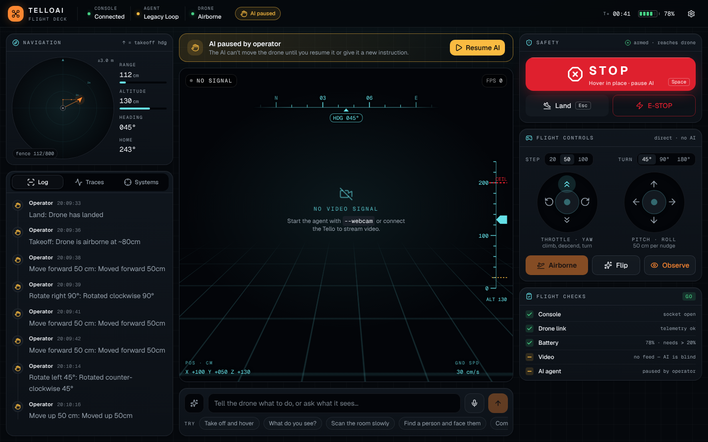

# Dashboard UI review and roadmap

## What was wrong with the previous console

I ran the old console in simulation and screenshotted it at 1440×900 and 390×844.

| Problem | Why it mattered |
|---|---|
| On phones, the camera view collapsed to zero height. | The most important panel disappeared completely. |
| The header STOP for narrow screens was pushed off-screen by the badges. | On a phone, the only quick STOP was out of reach. |
| Telemetry was eight plain number tiles. | Position, heading and the geofence are spatial. Numbers like "0, 50, 80" don't tell an operator where the drone is or how close it is to the 8 m fence. |
| The `T+` clock counted time since the page loaded. | It looked like flight time but wasn't. |
| The flight pad had no climb or descend, and step sizes were fixed. | Altitude could only be changed through the AI. |
| Takeoff stayed enabled while airborne. Land and Takeoff were in different panels. | The controls didn't reflect what the drone was doing. |
| The chat was squeezed into a tab at the bottom of the side panel, and tool calls were in a separate tab. | Talking to the AI is the main way to fly, and the operator couldn't see what the AI *did* next to what it *said*. |
| There was no sign that the AI was busy after a command was sent. | Operators re-send commands, which queues duplicate moves. |
| The empty states said "Awaiting command stream". | They didn't tell a new user how to start. |

## What the redesign does

- **Camera view with a HUD.** A heading tape, an altitude ladder with the ceiling and floor marked, a reticle, and position and ground-speed readouts are drawn over the video. LINK LOST covers the camera view, where the operator is already looking.
- **Navigation map.** A top-down plan centred on the takeoff point, with a flight trail, heading arrow, range rings and the geofence. It zooms from ±3 m out to the whole fence, and a bearing-home readout sits next to it.
- **Command line in the centre.** It has push-to-talk, an "AI working…" state, and suggestions that fill the field without sending, so nothing flies on a stray tap.
- **One mission log.** User commands, AI replies, AI tool calls (expandable), operator actions and safety events appear on a single timeline.
- **RC-style sticks.** Throttle/yaw on the left, pitch/roll on the right, with step sizes of 20/50/100 cm and 45/90/180°. Takeoff is disabled while airborne.
- **Pre-flight checklist.** Console, drone link, battery, video and agent checks give a GO / NO-GO verdict before a takeoff, and the same checks stay visible while flying.
- **A layout that keeps STOP visible:**
  - 3 columns at ≥1280 px, and the right rail doesn't scroll from 800 px tall upward.
  - 2 columns on laptops.
  - 1 column on phones, with STOP and Land pinned to the bottom edge.
- **Safety behaviour is unchanged.** Every operator path is the same as before: Space/Esc hotkeys, the two-step E-STOP, operator hold and Resume, and offline alerts. The existing tests for them still pass, and the new features have new tests (57 frontend tests in total).

## What to build next (highest value first)

1. **Keyboard flying (WASD / arrows + R/F for climb/descend).** The legacy pygame controller had this. It needs a "hold to arm" or focus mode so a stray key never moves the drone, and it must follow the same "ignore while typing" rules as Space/Esc.
2. **Show what the AI sees.** `search_for_object` already returns `found`, `location_in_frame` (left / center / right) and `confidence`. Sending that as a `detection` message and highlighting that third of the HUD makes "find a person" visible, not just narrated. Real bounding boxes would come next: Gemini can return `box_2d`, but the vision prompts don't ask for it yet.
3. **AI plan preview.** Before a multi-step move, show the planned path as a ghost line on the map, with Approve / Cancel. This turns the AI from "acts, then explains" into "proposes, then acts", which is the biggest safety and UX upgrade available.
4. **Expose `features/search.py` as a "Find…" mission.** It's already a working, safety-checked object search. A mission card (target, search radius, progress on the map) makes it a one-click feature.
5. **Waypoints by clicking the map.** Click to queue relative moves. The server already projects moves for the geofence check, so it can reject a waypoint before flying it.
6. **Flight replay.** Traces, tool calls and the trail are already recorded. A scrubber that replays a session (map + log + frames) is very useful for debugging the AI.
7. **Charts.** Battery and altitude over time in the Systems tab, with the warn and critical bands marked.
8. **Installable PWA + a tablet layout.** Phones and tablets are the natural controllers in the field. A manifest, a wake lock while flying, and bigger touch targets would make the tablet the primary controller.
9. **Live-mode voice.** Gemini Live already transcribes both sides, but the server sends each transcript only when the turn ends. Streaming partial transcripts would let you watch your words land while you talk, and the AI's reply could show a speaking indicator.

## How much more potential is there?

There's a lot. The backend is the hard part, and it's already strong: safety limits enforced in code, an operator hold, a watchdog, tracing, simulation, and a vision pipeline. Until now the UI showed only a small slice of that. The redesign shows *where the drone is* and *what the AI is doing*.

The next level is showing *what the AI intends* (plan preview, detection overlays). That's what turns this from a remote control with a chatbot into a supervised autonomy console. Items 2–4 above need only small backend changes, because the search routine, the vision calls and the move projection already exist.
