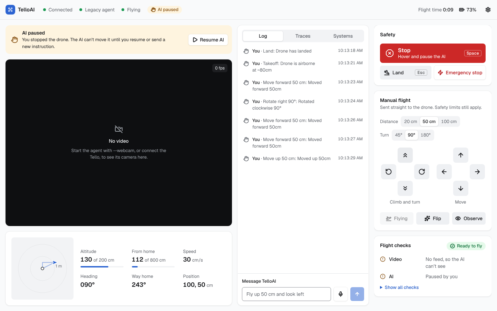
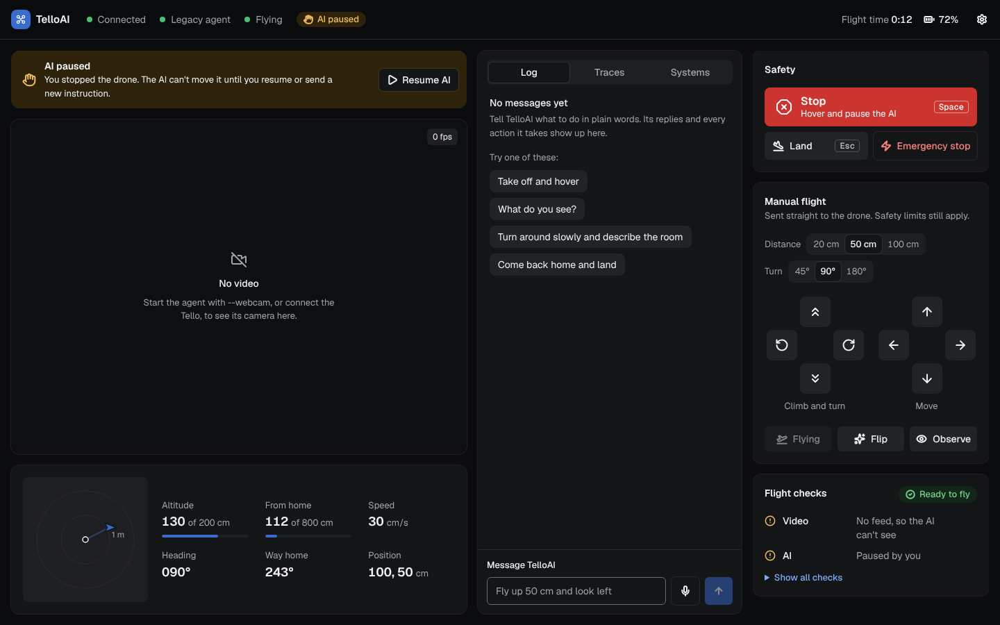

# Dashboard UI review and roadmap

## What was wrong with the previous console

I ran the old console in simulation and screenshotted it at 1440×900 and 390×844.

| Problem | Why it mattered |
|---|---|
| On phones, the camera view collapsed to zero height. | The most important panel disappeared completely. |
| The header STOP for narrow screens was pushed off-screen by the badges. | On a phone, the only quick STOP was out of reach. |
| Telemetry was eight plain number tiles. | Position, heading and the geofence are spatial. Numbers like "0, 50, 80" don't tell an operator where the drone is or how close it is to the 8 m fence. |
| The `T+` clock counted time since the page loaded. | It looked like flight time but wasn't. |
| The flight pad had no climb or descend, and step sizes were fixed. | Altitude could only be changed through the AI. |
| Takeoff stayed enabled while airborne. Land and Takeoff were in different panels. | The controls didn't reflect what the drone was doing. |
| The chat was squeezed into a tab at the bottom of the side panel, and tool calls were in a separate tab. | Talking to the AI is the main way to fly, and the operator couldn't see what the AI *did* next to what it *said*. |
| There was no sign that the AI was busy after a command was sent. | Operators re-send commands, which queues duplicate moves. |
| The empty states said "Awaiting command stream". | They didn't tell a new user how to start. |

## What the redesign does

The dashboard follows the `better-*` interface skills from [jakubkrehel/skills](https://github.com/jakubkrehel/skills): accessibility, layout, writing, typography, color and UI polish.

- **Color system.** One cool-tinted neutral ramp, one blue accent, and only the status colors the product shows (danger, warning, success). Each has a role token (`--primary-text`, `--destructive-subtle`, `--warning-text`, and so on). Every text and fill pair was measured with culori against WCAG 2.2 AA in both themes, and input borders clear 3:1. The camera area has its own media tokens, so it stays dark in both themes.
- **Light and dark.** The dashboard follows the system setting by default, with a Light / Dark override in Display settings. The theme is set before first paint, and transitions are suppressed for the frame the colors swap.
- **Surfaces.** Shadows give depth and borders only separate. Cards use the three-layer shadow in light mode and a single white ring in dark, with a transparent border for forced-colors mode. Nested radii are concentric.
- **Layout.** Grouping comes from space, and DOM order matches reading order: camera and flight data, then the conversation, then the controls. The page reflows at 320 px with no horizontal scroll, and on laptops the controls stay in view while you scroll.
- **Camera.** Plain video with small solid status pills, a "Link lost" message over it, and an empty state that says how to get video.
- **Flight data.** A small top-down map (flight path, heading, 8 m fence, auto-zoom) next to altitude, distance from home, speed, heading, the way home and position. Altitude and distance have meters against their limits.
- **Conversation.** A chat-style log with a visible "Message TelloAI" label. AI actions sit inline and open to show their full arguments and result. The empty state offers example instructions that fill the box without sending.
- **Controls.** Stop, Land and a confirmed Emergency stop; native radio buttons for distance and turn; two plus-shaped pads with 44 px targets; Take off is disabled while flying.
- **Pre-flight checks.** "Ready to fly" or "Not ready", listing only what needs attention, with all checks one click away.
- **Copy.** Sentence case, verb-first buttons ("Take off", "Cut motors"), plain status words ("Landed", "Flying", "Link lost") and errors that say what to do next.
- **Motion.** Transitions name their properties; buttons press to 0.96. Scale and movement run only when the user hasn't asked for reduced motion, and then toasts fade instead. Warnings and critical alerts stay until dismissed; screen readers hear them through live regions that exist from the start.
- **Safety behaviour is unchanged.** Every operator path is the same as before: Space/Esc hotkeys, the two-step Emergency stop, operator hold and Resume, and offline alerts. Their tests still pass. 58 frontend tests pass in total, and axe-core finds no WCAG 2.2 A/AA violations in either theme at desktop or phone width.

## What to build next (highest value first)

1. **Keyboard flying (WASD / arrows + R/F for climb/descend).** The legacy pygame controller had this. It needs a "hold to arm" or focus mode so a stray key never moves the drone, and it must follow the same "ignore while typing" rules as Space/Esc.
2. **Show what the AI sees.** `search_for_object` already returns `found`, `location_in_frame` (left / center / right) and `confidence`. Sending that as a `detection` message and highlighting that third of the camera view makes "find a person" visible, not just narrated. Real bounding boxes would come next: Gemini can return `box_2d`, but the vision prompts don't ask for it yet.
3. **AI plan preview.** Before a multi-step move, show the planned path as a ghost line on the map, with Approve / Cancel. This turns the AI from "acts, then explains" into "proposes, then acts", which is the biggest safety and UX upgrade available.
4. **Expose `features/search.py` as a "Find…" mission.** It's already a working, safety-checked object search. A mission card (target, search radius, progress on the map) makes it a one-click feature.
5. **Waypoints by clicking the map.** Click to queue relative moves. The server already projects moves for the geofence check, so it can reject a waypoint before flying it.
6. **Flight replay.** Traces, tool calls and the trail are already recorded. A scrubber that replays a session (map + log + frames) is very useful for debugging the AI.
7. **Charts.** Battery and altitude over time in the Systems tab, with the warn and critical bands marked.
8. **Installable PWA + a tablet layout.** Phones and tablets are the natural controllers in the field. A manifest, a wake lock while flying, and bigger touch targets would make the tablet the primary controller.
9. **Live-mode voice.** Gemini Live already transcribes both sides, but the server sends each transcript only when the turn ends. Streaming partial transcripts would let you watch your words land while you talk, and the AI's reply could show a speaking indicator.

## How much more potential is there?

There's a lot. The backend is the hard part, and it's already strong: safety limits enforced in code, an operator hold, a watchdog, tracing, simulation, and a vision pipeline. Until now the UI showed only a small slice of that. The redesign shows *where the drone is* and *what the AI is doing*, in a calm interface that holds up in daylight and dark rooms.

The next level is showing *what the AI intends* (plan preview, detection overlays). That's what turns this from a remote control with a chatbot into a supervised autonomy console. Items 2–4 above need only small backend changes, because the search routine, the vision calls and the move projection already exist.
