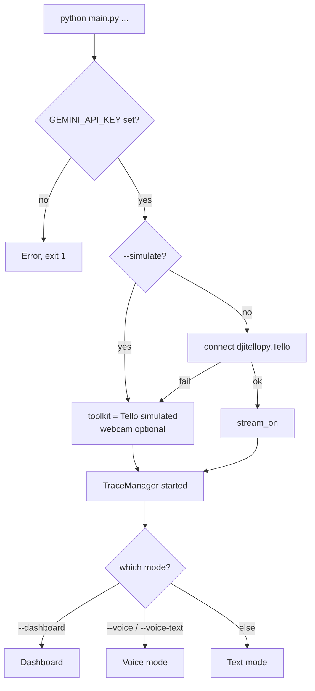
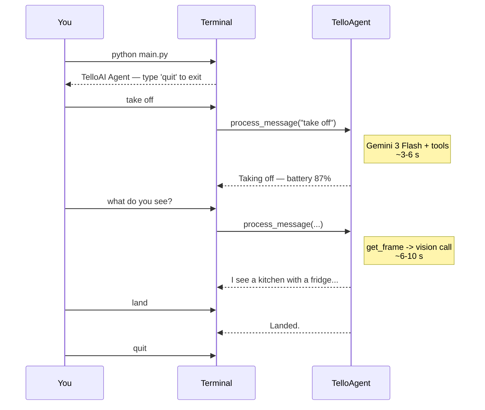
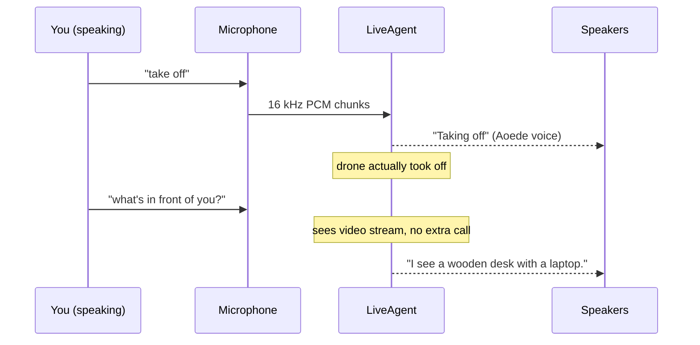
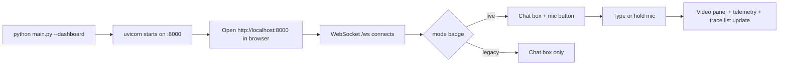
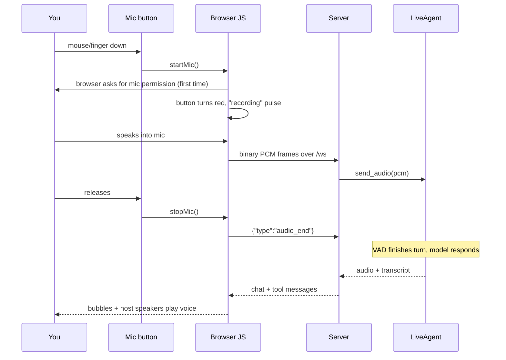

# User Flows

What the user actually does — and what happens visually and audibly — for every run mode. Use this doc as your "what do I type, what do I see, what can go wrong" reference.

## Modes at a glance

| Command | Mode | Model path | Input | Output |
|---|---|---|---|---|
| `python main.py` | Text | Legacy (Gemini 3 Flash) | Keyboard | stdout |
| `python main.py --voice` | Voice | Live | Microphone + keyboard | Aoede voice + stdout |
| `python main.py --voice-text` | Voice-text | Live | Keyboard | Aoede voice + stdout |
| `python main.py --dashboard` | Dashboard | Live (default) | Browser text + push-to-talk mic | Browser UI + host speakers |
| `python main.py --dashboard --legacy-agent` | Dashboard (legacy) | Legacy | Browser text | Browser UI only |
| any + `--simulate` | — | same as above | same | no drone |
| any + `--simulate --webcam` | — | same as above | same | laptop camera stands in for drone |

---

## Startup flow (every mode)



Entry point: `main.py` `187:241`.

### Environment prerequisites

| Variable / file | Purpose | Failure mode |
|---|---|---|
| `.env` with `GEMINI_API_KEY` | All agent modes | Hard exit at startup |
| WiFi `TELLO-XXXXXX` | Real drone | Falls back to simulation silently |
| A second network with internet | Calling Gemini while flying | Legacy agent hangs on API calls |
| `sounddevice`, `numpy` installed | `--voice` and dashboard audio | `RuntimeError: Audio libraries not installed…` |

Run `scripts/network_check.py` to verify your dual-WiFi setup.

---

## Flow A: Text mode (`python main.py`)



### What you'll see

1. Log line `TelloAI Agent — Interactive Text Mode`
2. Prompt `> ` — type English commands, not code
3. Every response is prefixed by a turnaround of `Gemini API ... took N.NN s` info log
4. If something breaks (drone disconnected, API error), the error text is returned as the assistant reply, not raised

### Common things to try

- `take off`
- `rotate 90 degrees clockwise`
- `move forward 50 cm`
- `what do you see?` (triggers `get_frame` + vision call)
- `go find a chair` (multi-step exploration — can take 30+ s)
- `land`

### Gotchas

- **No voice in this mode.** `--voice` is a separate flag.
- **Battery warnings are in-band** — the model itself says "battery low, landing now"; there's no separate notification.
- **Multi-step tasks hit the 15-iteration cap** (`core/agent.py` `138`). If the model bounces between `get_frame` and `rotate` forever, the loop exits and returns whatever text it has.

---

## Flow B: Voice mode (`python main.py --voice`)



### What you'll see in terminal

```
============================================================
  TelloAI Agent — Voice Mode (gemini-3.1-flash-live-preview)
  Speak to the drone. Ctrl+C to exit.
  You can also type a message — just press Enter.
============================================================
```

Spoken transcripts are printed as:
```
You: take off
TelloAI: Taking off.
  ✓ takeoff({})
```

### Interaction rules

- You can **speak or type** at any time. Typing goes through `send_text()`; speaking goes through the mic loop.
- **Barge-in works.** Talk over the drone and the output speaker flushes, then your new utterance is processed.
- Tool calls appear as `✓ toolname(args)` or `✗ toolname(args)` lines below the assistant reply.
- Ctrl+C triggers `toolkit.land()` if the drone is flying, then closes the session cleanly (`main.py` `143:153`).

### If the mic can't start

`main.py` `118:132` catches mic errors and falls back to text-only input (same as `--voice-text`). A log line `Couldn't start microphone:` tells you why. Usually one of:

- `sounddevice` not installed → `pip install sounddevice numpy`
- No default input device → check OS sound settings
- Another process is holding the mic exclusively

---

## Flow C: Voice-text mode (`python main.py --voice-text`)

Same as voice mode but skips mic startup. Useful when you:

- Don't have a microphone (headless machine, broken hardware)
- Want silent input but still want Aoede voice responses
- Are debugging the Live API without dealing with echo/acoustic issues

Everything else is identical — you still get spoken replies and drone video streaming into the session.

---

## Flow D: Dashboard mode (`python main.py --dashboard`)



### What you see on load

- **Left**: Live video panel (drone stream, webcam, or black placeholder for pure sim). Status text says `Live drone stream`, `Webcam stream`, or `No video source`.
- **Top right**: Telemetry — battery %, altitude, distance from home, heading.
- **Center**: Chat area with a "mode" badge labelled `live` or `legacy`.
- **Bottom right**: Trace list (clickable per trace — shows spans with thought summaries, tokens, costs).
- **Quick actions**: Takeoff, Land, Rotate 90°, Get Frame buttons that send canned commands.

### Chat interaction (text)

1. Type in the chat input, press Enter
2. Your message bubble appears immediately (role=`user`)
3. Server forwards to `LiveAgent.send_text()` or `TelloAgent.process_message()` depending on mode
4. In **live mode**: Aoede voice plays on the host machine's speakers + transcribed bubble appears when the turn completes
5. In **legacy mode**: text bubble appears 8–15 s later; no audio

### Chat interaction (push-to-talk mic, live mode only)



First press prompts browser permission. Subsequent presses just record.

### Quick-action buttons

Located above the chat input. Each sends a fixed English command:

| Button | Sends | Equivalent typed |
|---|---|---|
| Takeoff | `"take off"` | same |
| Land | `"land"` | same |
| Rotate 90° | `"rotate 90 degrees clockwise"` | same |
| Get Frame | `"describe what you see right now"` | same |

The Live path answers over voice; the legacy path replies in text.

### Running without a microphone / speakers

Both are optional for dashboard:

- **No speakers** — the server log says `Could not start host speaker (continuing without audio playback): ...` and everything else works. You lose Aoede voice but still see transcript bubbles.
- **No mic** — just don't press the mic button. Type instead.

---

## Flow E: Simulation (`--simulate`)

Adds `--simulate` to any of the above modes.

### What changes

- `toolkit.tello` is `None`. Every drone method updates `DroneState` but doesn't touch hardware (`core/toolkit.py` — see any method, check for `if self.simulate:` branch).
- `get_frame` returns either a black placeholder or a webcam frame if `--webcam` is set.
- Toolkit logs `[SIM]` in action log entries so traces are distinguishable.
- Everything else behaves identically — LLM still plans, safety still runs, tool results still feed back into the model.

### With `--webcam`

- Uses `cv2.VideoCapture(0)` as the frame source
- Perfect for testing vision pipelines without flying
- Released on exit (`main.py` `234:236`)

---

## Error signatures and what to do

| Symptom | Likely cause | Fix |
|---|---|---|
| `GEMINI_API_KEY not set` → exit | No `.env` or wrong key | `cp .env.example .env` and fill in |
| `Failed to connect to drone` → sim fallback | Not on Tello WiFi | Connect to `TELLO-XXXXXX` or accept sim mode |
| `Audio libraries not installed` | Missing `sounddevice`/`numpy` | `pip install sounddevice numpy` |
| Dashboard shows "No video source" | `--simulate` without `--webcam` | Add `--webcam`, or connect to drone |
| Chat is slow in dashboard | Badge shows `legacy`, or no internet | Remove `--legacy-agent`, check network_check.py |
| Browser mic does nothing | Not on `https://` or `http://localhost` | Use localhost — `getUserMedia` is blocked on LAN IPs |
| Voice still sounds choppy | Laptop speakers + noisy environment, echo guard too short | Bump `_echo_guard_ms` to 800 in `voice/gemini_live.py`, or use headphones |
| Can't interrupt TelloAI's reply with voice | Half-duplex echo gate is active | Type a message instead, or use headphones + lower `_echo_guard_ms` |
| Response starts 200 ms after model begins speaking | Speaker prebuffer absorbing jitter | Expected; lower `prebuffer_ms` in `SpeakerPlayer(...)` if you want faster but riskier playback |
| Drone doesn't land on Ctrl+C | Shutdown hook errored | `main.py` `226:236` always tries to land; check logs for exceptions |

## See also

- [workflow.md](./workflow.md) — what's happening under each of these flows technically
- [safety.md](./safety.md) — why some commands get refused or modified
- [components.md](./components.md) — module reference
