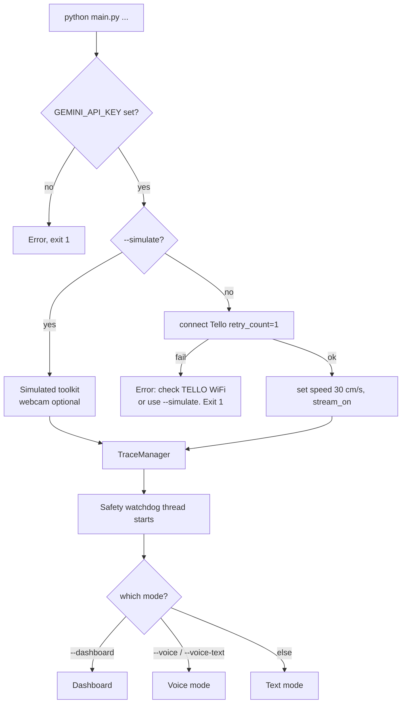
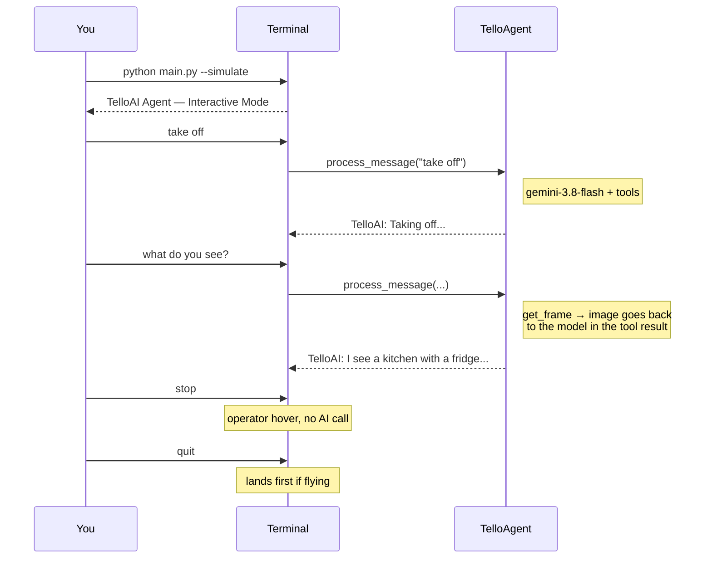
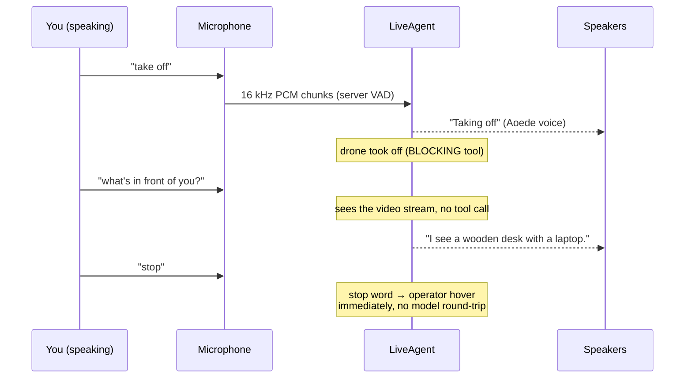
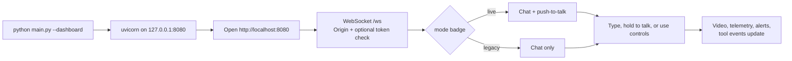
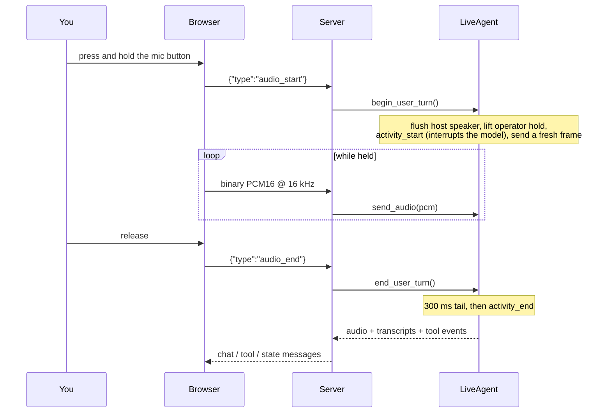

# User Flows

What the user actually does, and what happens visually and audibly, for every run mode. Use this doc as your "what do I type, what do I see, what can go wrong" reference.

Commands below use `python` for brevity. On Windows use `.\venv\Scripts\python.exe`.

## Modes at a glance

| Command | Mode | Model path | Input | Output |
|---|---|---|---|---|
| `python main.py` | Text | Text agent (`gemini-3.8-flash`) | Keyboard | stdout |
| `python main.py --voice` | Voice | Live (`gemini-3.8-live`), open mic | Microphone + keyboard | Aoede voice + stdout |
| `python main.py --voice-text` | Voice-text | Live | Keyboard | Aoede voice + stdout |
| `python main.py --dashboard` | Dashboard | Live (default), push-to-talk | Browser chat, push-to-talk, buttons, hotkeys | Browser UI + **host** speakers |
| `python main.py --dashboard --legacy-agent` | Dashboard (legacy) | Text agent | Browser chat, buttons, hotkeys | Browser UI only |
| any + `--simulate` | | same as above | same | no drone |
| any + `--simulate --webcam` | | same as above | same | laptop camera stands in for the drone |

---

## Startup flow (every mode)



### Environment prerequisites

| Variable / file | Purpose | Failure mode |
|---|---|---|
| `.env` with `GEMINI_API_KEY` | All modes | Hard exit at startup |
| WiFi `TELLO-XXXXXX` | Real drone | Hard exit with a hint to run `scripts/network_check.py` or use `--simulate` |
| A second network with internet | Calling Gemini while flying | API calls fail or hang |
| `sounddevice`, `numpy` | `--voice` and dashboard host audio | Voice falls back to typed input; dashboard runs without audio playback |
| `dashboard/static_dist` (built) | `--dashboard` | Browser shows "Dashboard build not found" (HTTP 503) |

Run `scripts/network_check.py` to verify your dual-WiFi setup.

### Operator words work in every mode

Typing exactly one of these (in the CLI or in the dashboard chat) acts immediately, without the AI:

| Typed | Action |
|---|---|
| `stop` or `hover` | Hover in place; AI motion is put on hold and any command still waiting for the drone is cancelled |
| `land` | Land; AI motion is put on hold |
| `!estop` | Emergency motor cut: the drone falls |
| `resume` | Lift the hold (any new instruction also lifts it) |

Each typed operator word runs on its own thread, so `!estop` works even while a `land` is still waiting for the drone.

---

## Flow A: Text mode (`python main.py`)



### What you'll see

1. Banner `TelloAI Agent — Interactive Mode` with the operator-word hint
2. Prompt `You: `. Type plain English.
3. Each model call logs `Gemini API (aio.models.generate_content) took N.NNs`; each tool logs its result
4. Replies print as `TelloAI: ...`. API errors come back as the reply (`Sorry, I encountered an error: ...`), not as a crash.
5. Watchdog alerts print as `[SAFETY WARNING] ...` / `[SAFETY CRITICAL] ...`

Input is read on a background thread, so `stop`, `land` and `!estop` work even while the agent is still thinking or a move is running. A second instruction typed while one is in progress is rejected with a hint to use `stop` or `land`.

Other commands: `status` (state JSON), `reset` (clear history), `quit`/`exit` (lands first).

### Common things to try

- `take off`
- `rotate 90 degrees clockwise`
- `move forward 50 cm` (anything over 100 cm is clamped to 100 cm)
- `what do you see?` (one `get_frame`; the model looks at the image itself)
- `go find a chair` (the model scans with rotate + get_frame; can take 30+ s)
- `land`

### Gotchas

- **No voice in this mode.** `--voice` is a separate flag.
- **Takeoff is refused at ≤20 % battery.**
- **Multi-step tasks hit the 15-call cap** (`MAX_ITERATIONS` in `core/agent.py`). The agent then stops and says so.
- **Old camera images are dropped** from history after each turn to save tokens; the model calls `get_frame` again when it needs a current view.

---

## Flow B: Voice mode (`python main.py --voice`)



### What you'll see in the terminal

```
============================================================
  TelloAI Agent — Voice Mode (gemini-3.8-live)
  Tip: use headphones — laptop speakers echo into the mic.
  Speak to the drone. Ctrl+C to exit.
  You can also type a message — just press Enter.
============================================================
  Typed 'stop' / 'land' / 'resume' act instantly (no AI); '!estop' cuts motors.
```

Transcripts and tool calls print as:

```
You: take off
TelloAI: Taking off.
  ✓ takeoff({})
```

### Interaction rules

- You can **speak or type** at any time. Typed text goes through `send_text()`; typed operator words go straight to the drone.
- **Spoken stop words** ("stop", "hover", "freeze", "hold", "land", "land now", optionally with "please"/"okay") act immediately through the operator path. The AI is then on hold until your next instruction.
- **Echo gate.** The mic is muted while TelloAI speaks and for 500 ms afterwards, so you **can't talk over it** in this mode. Wait for it to finish, type `stop`, or use headphones. The dashboard's push-to-talk does support barge-in.
- Watchdog warnings (low battery, link lost) are printed and also spoken by the model.
- If the Live connection drops, it reconnects automatically (resuming the session when possible) and prints `[system]` messages.
- Ctrl+C or `quit` lands the drone if it is flying, then closes the session.

### If the mic can't start

`run_voice_mode` catches mic errors, logs `Couldn't start microphone: ...`, and continues with typed input only (same as `--voice-text`). Usually one of:

- `sounddevice` not installed → `.\venv\Scripts\python.exe -m pip install sounddevice numpy`
- No default input device → check the OS sound settings
- Another process is holding the mic exclusively

---

## Flow C: Voice-text mode (`python main.py --voice-text`)

Same as voice mode but skips the mic. Useful when you:

- Don't have a microphone
- Want silent input but still want Aoede voice responses
- Are debugging the Live API without echo or acoustic issues

You still get spoken replies and drone video in the session.

---

## Flow D: Dashboard mode (`python main.py --dashboard`)



### What you see on load

The dashboard follows your system's light or dark setting; change it under **Display settings** (gear icon). On wide screens (≥1280 px) it shows three columns, on laptops two, and on phones one stacked column. The page reads in this order:

- **Top bar**: connection, AI agent (Gemini Live or legacy agent), drone state (landed, flying or link lost), an `AI paused` label when it applies, flight time, battery, and Display settings (theme, camera feed, voice messages, response time and frame rate).
- **Camera and flight data**:
  - The "AI paused" banner, with **Resume AI**, after you press Stop, Land or Emergency stop.
  - The camera view. When the drone link drops, a **Link lost** message covers it.
  - Flight data: a small top-down map from the takeoff point (up is the takeoff heading) with the flight path and the 8 m fence. It zooms from ±2.5 m out to the whole fence. Beside it are altitude (of the 2 m ceiling), distance from home (of the 8 m fence), speed, heading, the way home and position.
- **Conversation**: Log, Traces and Systems tabs above the **Message TelloAI** box (text, or the microphone button for voice). The log puts your messages, the AI's replies, each action the AI takes (open one to see its arguments and result), your direct actions and safety events on one timeline. While it's empty, it offers example instructions; selecting one fills the box without sending it.
- **Controls** (they stay in view while you scroll on laptops):
  - **Safety**: **Stop** (Space), **Land** (Esc) and **Emergency stop**, which asks you to confirm "Cut motors" within 5 s.
  - **Manual flight**: pick a distance (20 / 50 / 100 cm) and a turn angle (45 / 90 / 180°), then use the **Climb and turn** and **Move** pads. Below them are Take off (disabled while flying), Flip forward, and **Observe**, which asks the AI to describe the view without moving and does not lift a Stop. Everything except Observe goes straight to the drone, with safety limits still applied. One manual command runs at a time: pressing again while the previous one runs shows "Drone is busy with the previous manual command".
  - **Pre-flight checks**: dashboard, drone link, battery, video and AI. It says "Ready to fly" or "Not ready", lists only what needs attention, and can show all checks.
- **Phones**: Stop and Land are pinned to the bottom of the screen.
- **Alerts** appear above the camera. Notices disappear after 6 s; warnings and critical alerts stay until you dismiss them.

### Keyboard shortcuts

| Key | Action |
|---|---|
| Space | STOP (hover, AI on hold) |
| Esc | Land (AI on hold) |

Shortcuts are ignored while you type in a field or inside a popover, and key repeat is ignored. There is no E-STOP shortcut on purpose.

### Chat interaction (text)

1. Type in the chat input and press Enter
2. Exact operator words (`stop`, `land`, `resume`, `!estop`) act immediately without the AI
3. Anything else goes to `LiveAgent.send_text()` or `TelloAgent.process_message()`, which lift the operator hold when the new turn starts. A message you sent before pressing STOP doesn't lift it, and a Live message that couldn't be delivered doesn't either.
4. **Live mode**: the Aoede voice plays on the **host machine's** speakers; transcript bubbles appear when the turn completes; tool events appear as they run
5. **Legacy mode**: a text bubble appears when the whole function-calling loop finishes; no audio

### Push-to-talk (live mode only)



The first press prompts for mic permission. Holding the button while TelloAI is talking interrupts it (real barge-in). Saying just "stop" or "land" acts immediately through the operator path.

### Running without a microphone or speakers

- **No speakers**: the server logs `Could not start host speaker (continuing without audio playback): ...`. You lose the voice but still see transcript bubbles.
- **No mic**: don't press the mic button. Type instead.

### Opening the dashboard from another device

The server binds `127.0.0.1` by default. To reach it from a phone or another PC, set `DASHBOARD_HOST=0.0.0.0` **and** `DASHBOARD_TOKEN`, then open `http://<pc-ip>:8080/?token=<token>`. Browsers only allow the microphone on `localhost` or HTTPS, so push-to-talk usually won't work from a LAN IP.

---

## Flow E: Simulation (`--simulate`)

Add `--simulate` to any of the modes above.

### What changes

- `toolkit.tello` is `None`. Every drone method updates `DroneState` without touching hardware.
- `get_frame` returns a gray placeholder, or a webcam frame with `--webcam`.
- The battery starts at 100 % and drains at 7.5 %/min while flying, so the watchdog's low-battery warning and force-land can be exercised.
- Everything else is identical: the LLM still plans, safety checks and the operator hold still apply, and tool results still feed back into the model.

### With `--webcam`

- Uses `cv2.VideoCapture(0)` as the frame source (falls back to the placeholder if it can't open)
- Good for testing vision without flying
- Released on exit

---

## Error signatures and what to do

| Symptom | Likely cause | Fix |
|---|---|---|
| `GEMINI_API_KEY not set` → exit | No `.env` or no key | `Copy-Item .env.example .env` and fill it in |
| `Could not connect to the Tello...` → exit | Not on the Tello WiFi | Connect to `TELLO-XXXXXX`, run `scripts/network_check.py`, or add `--simulate` |
| Browser shows "Dashboard build not found" | Frontend not built | `cd dashboard\frontend; npm install; npm run build` |
| Dashboard stays "disconnected" | Origin not allowed, or a token is required | Open it at `http://localhost:8080`; with a token, add `?token=...`; for a custom origin set `DASHBOARD_ALLOWED_ORIGINS` |
| Dashboard shows no video | `--simulate` without `--webcam` | Add `--webcam`, or connect to the drone |
| `Audio libraries not installed` | Missing `sounddevice`/`numpy` | `.\venv\Scripts\python.exe -m pip install sounddevice numpy` |
| Browser mic does nothing | Not on `https://` or `http://localhost` | Use localhost; `getUserMedia` is blocked on plain-HTTP LAN IPs |
| AI says "Operator hold" and won't move | You (or the watchdog) pressed STOP/Land | Press **Resume AI**, type `resume`, or give a new instruction (Observe doesn't lift the hold) |
| "Cancelled: the operator stopped the drone while this command was waiting." | A STOP/Land/E-STOP happened while the command was queued | Intended: nothing queued flies after a stop. Give the instruction again |
| "Drone is busy with the previous manual command" | A flight-pad press while the previous one is still running | Wait for it to finish |
| "A land is already in progress" | Land pressed again (or the watchdog retried) during a landing | Wait, or use E-STOP |
| "Drone busy: land was sent without confirmation..." | The drone didn't free up within 25 s; a raw `land` was sent | Watch the drone; use E-STOP if it doesn't descend. It stays marked as flying until the sensor shows ground |
| `[SAFETY ...] ... resynced` | The height sensor disagreed with the flying/landed state for 3 watchdog ticks (~3 s) | Check the drone; keepalive and battery protection follow the sensor |
| "Voice link reconnecting…" in chat | Live connection recycled or dropped | Wait; it resumes automatically. "restart required" means it gave up: restart the app |
| Can't interrupt TelloAI by voice in `--voice` | Open-mic echo gate | Use headphones and wait, type `stop`, or use the dashboard's push-to-talk |
| Chat is slow in the dashboard | Badge shows `legacy`, or a slow uplink | Remove `--legacy-agent`; check `network_check.py` |
| Drone doesn't land on Ctrl+C | Shutdown landing failed | `main.py` always tries `operator_command("land")`; check the logs |

## See also

- [workflow.md](./workflow.md): what happens under each of these flows technically
- [safety.md](./safety.md): why some commands get refused or modified
- [components.md](./components.md): module reference
