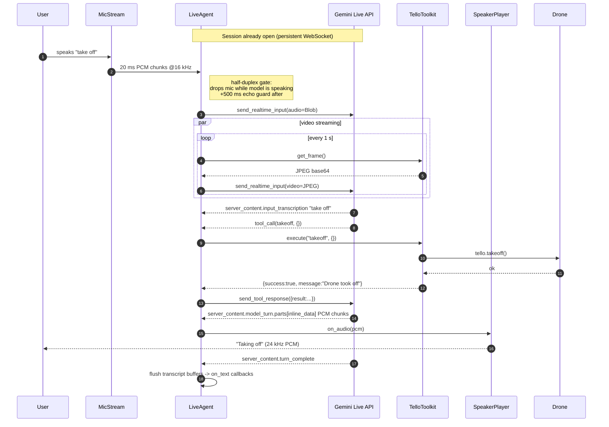
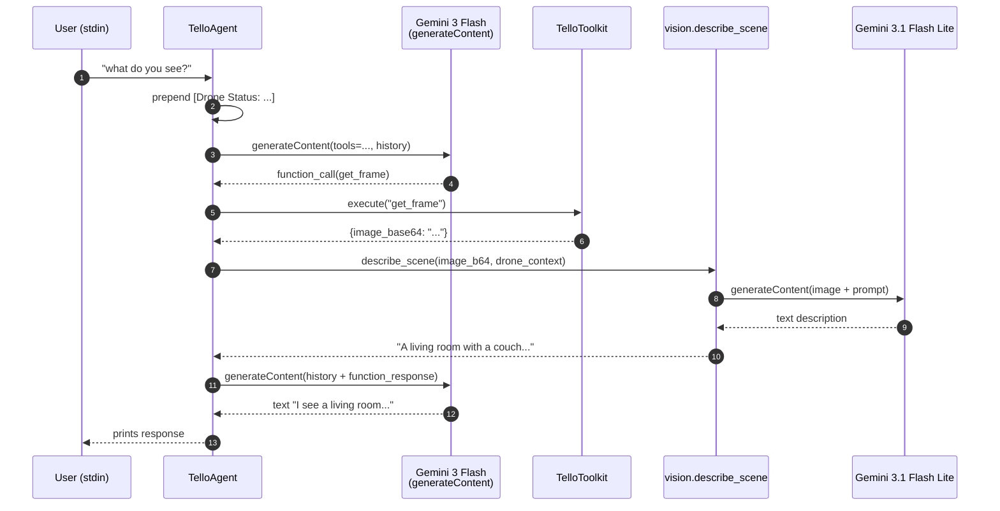
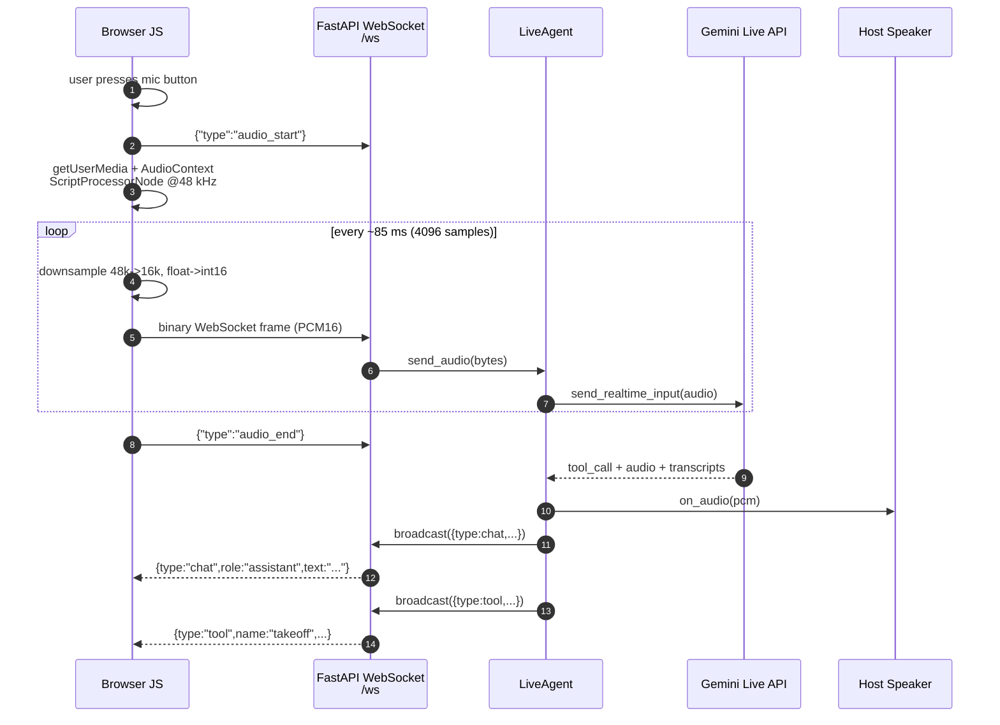
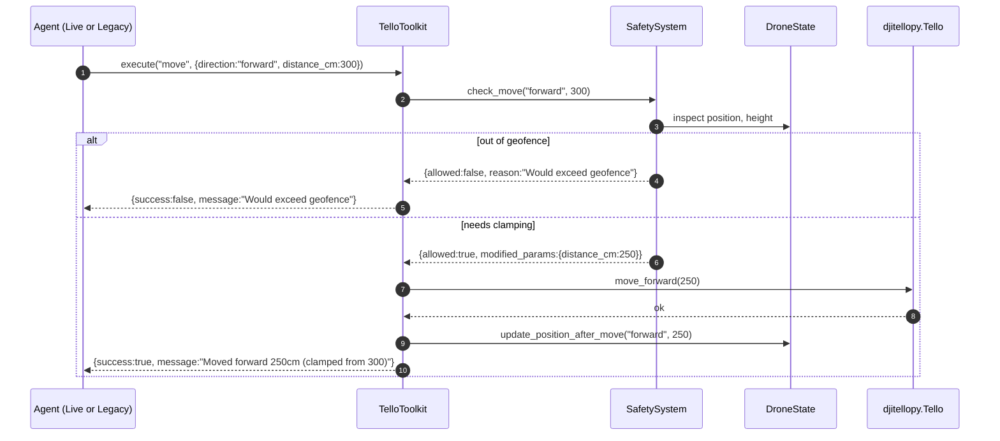
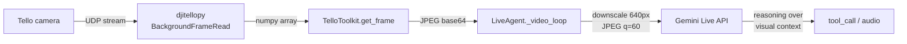
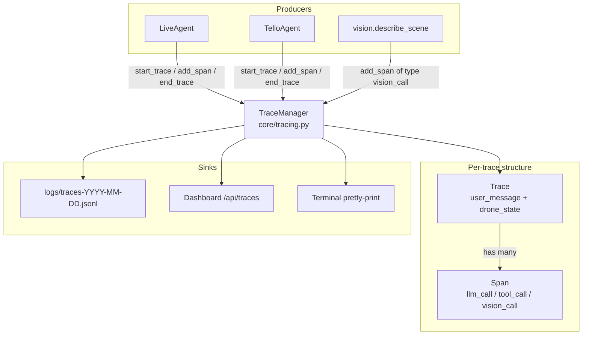

# Technical Workflow

How a request flows through the system, step by step. This doc walks through every major runtime path with sequence diagrams.

## Paths covered

1. [Live voice turn](#1-live-voice-turn-voice-default-dashboard) — end-to-end voice conversation over `gemini-3.1-flash-live-preview`
2. [Legacy text turn](#2-legacy-text-turn-default-text-mode) — classic multi-step function-calling loop
3. [Dashboard push-to-talk](#3-dashboard-push-to-talk-mic) — browser mic → server → Live API
4. [Tool execution inside the toolkit](#4-tool-execution-inside-the-toolkit)
5. [Video streaming into the Live session](#5-video-streaming-into-the-live-session)
6. [Tracing pipeline](#6-tracing-pipeline)

---

## 1. Live voice turn (`--voice`, default dashboard)

### Sequence

### Code map

| Step | File | Lines |
|---|---|---|
| Open session | `voice/gemini_live.py` | `174:217` |
| Mic capture loop | `main.py` | `116:128` |
| Send audio (with half-duplex gate) | `voice/gemini_live.py` | `255:277` |
| Video loop | `voice/gemini_live.py` | `290:306` |
| Handle server responses | `voice/gemini_live.py` | `321:375` |
| Execute tool calls | `voice/gemini_live.py` | `377:440` |
| Callback-driven speaker with jitter prebuffer | `voice/audio.py` | `101:210` |

### Key properties

- **One WebSocket per session.** Opened in `LiveAgent.start()` via `client.aio.live.connect()` and torn down in `stop()`.
- **Voice Activity Detection** is server-side. The model decides turn boundaries. The client never signals "end of speech".
- **Transcriptions arrive separately from audio.** Audio chunks stream as they synthesize; transcript text arrives as partial chunks that are only flushed to the `on_text` callback on `turn_complete`. That's why the dashboard chat bubble appears after the voice finishes, not while it's speaking.
- **Half-duplex echo gate (client-side).** While the model is emitting audio, `send_audio()` drops incoming mic chunks (`voice/gemini_live.py` `255:277`). A 500 ms "echo guard" extends this window past the last model audio chunk to cover speaker playback latency. This prevents the feedback loop where the model's own voice, re-captured by the mic, registers as user speech and triggers spurious interruptions.
- **Interruptions are gated too.** `server_content.interrupted=true` events are only honored when the model is not currently speaking (`voice/gemini_live.py` `363:368`). Events that arrive during model playback are almost always acoustic echo and are ignored — otherwise the speaker would flush and cut the reply mid-sentence.
- **Jitter-buffered playback.** `SpeakerPlayer` uses a callback-driven `sounddevice.OutputStream` that pre-buffers 200 ms before playback starts (`voice/audio.py` `101:210`). This absorbs network jitter on the Live API WebSocket; chunks that arrive slightly late don't cause audible gaps.
- **Trade-off.** Together these two gates make voice barge-in unreliable on laptop speakers. Users who want real full-duplex barge-in should wear headphones — no acoustic path, no echo, no need for the gates (see [components.md](./components.md#voicegemini_livepy--liveagent) for how to tune `_echo_guard_ms`).

---

## 2. Legacy text turn (default text mode)

### Sequence

### Code map

| Step | File | Lines |
|---|---|---|
| User input loop | `core/agent.py` | `268:325` (approx, see `run_interactive`) |
| State context prepended | `core/agent.py` | `120:123` |
| Gemini call | `core/agent.py` | `169:182` |
| Function execution | `core/agent.py` | `272:326` |
| Vision substitution for `get_frame` | `core/agent.py` | `305:319` |
| History growth | `core/agent.py` | `130:135`, `262:262`, `328:339` |

### Loop termination

The `while iteration < max_iterations` loop in `process_message` (`core/agent.py` `141:`) exits when the model returns a response with **no function calls** — i.e. a plain text answer. The cap is **15 iterations** per user message as a runaway guard.

### Why the legacy path is slow

Each full turn typically issues:

1. One `generateContent` call for planning (~3–6 s with thinking enabled)
2. One `generateContent` call for every frame observed (~2–3 s each)
3. Another `generateContent` call to synthesize the final answer

Total: **8–15 s** for typical "look at the scene and tell me" requests. The Live path eliminates (2) and (3) by doing perception and speech inside the same session.

---

## 3. Dashboard push-to-talk mic

### Sequence

### Code map

| Step | File | Lines |
|---|---|---|
| Mic button + visual state | `dashboard/static/script.js` | `startMic`, `stopMic`, `updateMicButton` |
| Downsample + PCM16 encode | `dashboard/static/script.js` | `downsample`, `floatTo16BitPCM` |
| Binary frame accepted | `dashboard/server.py` | `156:166` |
| Audio forwarded to Live | `dashboard/server.py` | `163:166` |
| Responses broadcast back | `dashboard/server.py` | `63:94` |

The server is the only place that knows the Live API exists — the browser just streams PCM and listens for JSON events.

---

## 4. Tool execution inside the toolkit

Every drone action passes through `TelloToolkit.execute()`, which dispatches to the right method and enforces safety.

### Code map

| Responsibility | File | Lines |
|---|---|---|
| Dispatch table | `core/toolkit.py` | `329:372` |
| Safety check functions | `core/safety.py` | whole file |
| Dead reckoning update | `core/state.py` | `update_position_after_move`, `update_heading_after_rotate` |
| Action log append | `core/state.py` | in `update_*` calls |

### What "safety allowed" actually guarantees

- Battery is above the action's minimum (`SAFETY["battery_warn"]` for normal moves, higher for flips)
- Target position stays inside the **geofence radius** around (0,0,0) — the takeoff point
- Altitude stays within `[SAFETY["altitude_min_cm"], SAFETY["altitude_max_cm"]]`
- Distance per move stays within `SAFETY["move_max_cm_per_step"]`, otherwise it's clamped not rejected
- No kill switch has been triggered (`SafetySystem._force_land_requested`)

See [safety.md](./safety.md) for the full rules and thresholds.

---

## 5. Video streaming into the Live session

- **Source selection** — `core/toolkit.py` `get_frame` picks real drone, webcam (simulation + `--webcam`), or an all-black placeholder for pure simulation
- **Encoding for the model** — re-encoded down to `LIVE["video_max_side"]=640` px, quality `LIVE["video_jpeg_quality"]=60`. Small frames keep upstream bandwidth under ~20 KB/s at 1 FPS.
- **Rate** — 1 frame per second (`LIVE["video_fps"]`). Increasing this costs more tokens per minute but gives the model finer-grained scene changes.

### Why `get_frame` / `stream_on` / `stream_off` are disabled in Live mode

`LIVE["disabled_tools"]` removes these from the function-calling schema (`voice/gemini_live.py` `62:90`). The model doesn't need them — it already sees every frame. Exposing them would just lead it to redundantly "request a frame" and inflate latency. They remain available in the legacy path.

---

## 6. Tracing pipeline

### Span types

| `span_type` | Produced by | Key fields |
|---|---|---|
| `llm_call` | `core/agent.py` | `model`, `tokens_in`, `tokens_out`, `thinking_tokens`, `cost_usd`, `input_messages`, `output_message`, `thought_summary` |
| `tool_call` | `core/agent.py`, `voice/gemini_live.py` | `tool_name`, `tool_args`, `tool_result`, `status` |
| `vision_call` | `vision/llm_vision.py` | `model`, tokens, `image_thumbnail_base64` |

### Cost accounting

`core/cost.py` holds per-model pricing (USD per 1 M tokens). `calculate_cost(model, tokens_in, tokens_out, thinking_tokens)` is called inline when a `llm_call` span is emitted. Costs accumulate on the trace and surface in the dashboard trace viewer.

Live API sessions emit only **one trace** (covering the whole conversation) and only **tool_call spans** inside it — the Live SDK doesn't hand back detailed token metadata per turn the same way `generateContent` does.

---

## Live vs Legacy latency

| Step | Live | Legacy |
|---|---|---|
| Network round trip (API call) | 1 WebSocket, already open | New HTTPS POST per iteration |
| Perception | Included in same session | Separate `describe_scene` call |
| First audio chunk after user input | ~0.4–0.8 s | N/A (text only) |
| Final text reply | ~1.0–2.0 s | 8–15 s typical |
| Tool call round trip | ~0.3–0.6 s | ~0.5–1.0 s |

If your dashboard chat feels slow, check:

1. Is `use_live` actually `True`? Check the server log line `"Dashboard will use Gemini Live API (fast path)"` (`main.py` `174`).
2. Is the mode badge on the UI showing "live"? The server broadcasts `{type:"mode", mode:"live"|"legacy"}` on connect (`dashboard/server.py` `151:154`).
3. Are you on the drone's WiFi? If so, Gemini API calls might be going through a very slow uplink. Run `scripts/network_check.py` to verify.

## See also

- [architecture.md](./architecture.md) — the shape of the system these flows run inside
- [components.md](./components.md) — module-level reference
- [user-flows.md](./user-flows.md) — user-visible equivalent of these technical flows
- [safety.md](./safety.md) — safety layer details referenced from tool execution
