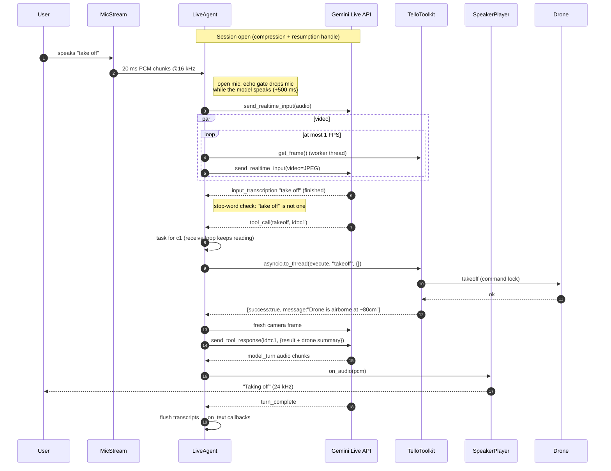
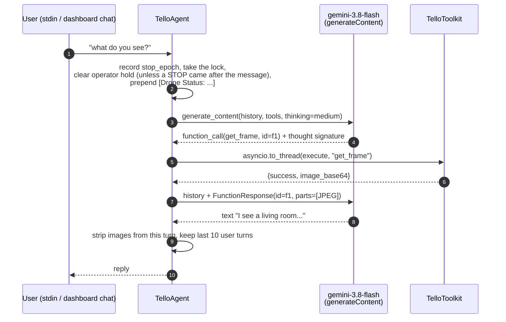
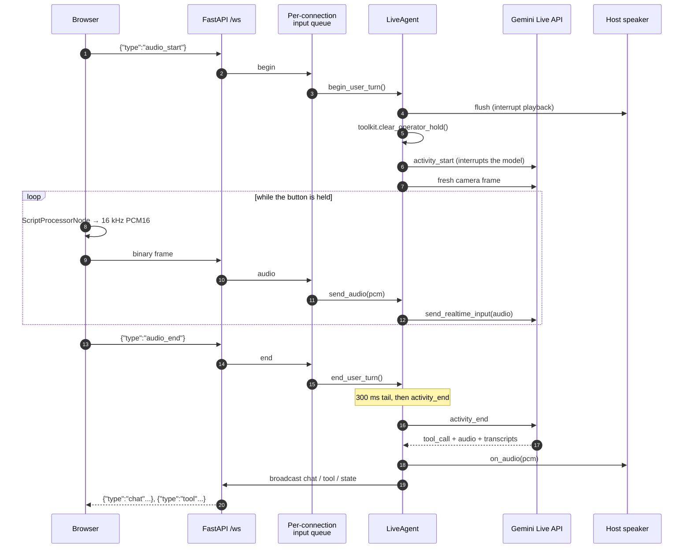
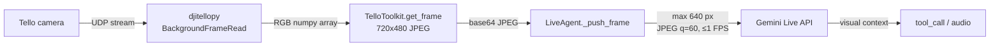
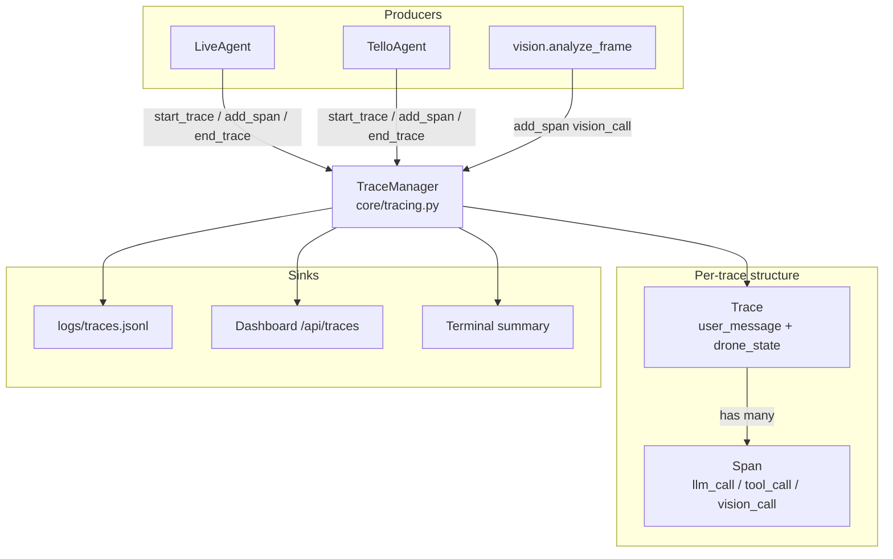

# Technical Workflow

How a request flows through the system, step by step. This doc walks through every major runtime path with sequence diagrams.

## Paths covered

1. [Live voice turn](#1-live-voice-turn---voice-default-dashboard): end-to-end voice conversation over `gemini-3.8-live`
2. [Text-agent turn](#2-text-agent-turn-default-text-mode---legacy-agent): multi-step function-calling loop on `gemini-3.8-flash`
3. [Dashboard push-to-talk](#3-dashboard-push-to-talk): browser mic → server → Live API
4. [Tool execution inside the toolkit](#4-tool-execution-inside-the-toolkit)
5. [Operator commands](#5-operator-commands): STOP / Land / E-STOP without the AI
6. [Video into the Live session](#6-video-into-the-live-session)
7. [Tracing pipeline](#7-tracing-pipeline)

---

## 1. Live voice turn (`--voice`, default dashboard)

### Sequence



### Code map

| Step | File | Symbol |
|---|---|---|
| Session config | `voice/gemini_live.py` | `build_live_config`, `_build_live_tools` |
| Open / supervise / reconnect | `voice/gemini_live.py` | `start`, `_supervise`, `_reconnect`, `_drain_then_reconnect` |
| Mic capture loop | `main.py` | `run_voice_mode` → `mic_pump` |
| Send audio (echo gate) | `voice/gemini_live.py` | `send_audio` |
| Server messages | `voice/gemini_live.py` | `_handle_response` |
| Stop-word fast path | `voice/gemini_live.py` | `match_stop_word`, `_finish_utterance` |
| Tool calls | `voice/gemini_live.py` | `_schedule_tool_calls`, `_run_tool_call`, `_cancel_tool_calls`, `_respond` |
| Speaker with jitter prebuffer | `voice/audio.py` | `SpeakerPlayer` |

### Key properties

- **One logical session, many connections.** A connection lasts about 10 minutes. On `go_away`, the agent lets in-flight tools finish, waits for a resumable handle and reconnects with it. A dropped connection reconnects with exponential backoff (5 attempts). Context-window compression lifts the 2-minute cap on audio+video sessions.
- **Tool calls never cross connections.** When a connection is lost, its tool calls that haven't started are cancelled and running ones finish (`_orphan_tool_calls`); none of their responses go to the new connection. After reconnecting, the model gets one system notice listing what ran, what was cancelled and the current drone status.
- **BLOCKING tools, run as tasks.** Each tool call is its own task keyed by call id, so the receive loop keeps reading `go_away` and `tool_call_cancellation` while the drone moves. Calls still execute one at a time, in order (`_tool_lock`).
- **Cancellation aborts motion.** If the server cancels a running takeoff/move/rotate (for example on barge-in), the agent calls `toolkit.hover()`, which bumps `stop_epoch` so commands still waiting for the drone are cancelled too.
- **Spoken stop words beat the model.** An utterance that is only "stop", "hover", "land now" etc. runs `operator_command` immediately on a dedicated thread (`operator_command_background`), not the shared executor that busy tool calls could saturate. Tool calls that arrive afterwards wait for it, so the operator hold is set before they execute.
- **Turn taking.** CLI: server-side VAD (`START_SENSITIVITY_LOW`, 500 ms silence). Dashboard: push-to-talk with explicit `activity_start` / `activity_end` (see §3).
- **Transcripts arrive separately from audio.** Transcript chunks are buffered and flushed to `on_text` on `turn_complete`, so a chat bubble appears after the voice finishes.
- **Half-duplex echo gate (open mic only).** `send_audio()` drops mic chunks while the model speaks and for 500 ms after its last audio chunk. Barge-in by voice is therefore not possible in `--voice`; use headphones, type `stop`, or use the dashboard's push-to-talk. Server `interrupted` events always flush local playback.
- **Jitter-buffered playback.** `SpeakerPlayer` prebuffers 200 ms before playing and re-prebuffers on underrun.
- **Safety notices.** Watchdog warnings reach the model through `send_system_notice()`, marked as coming from the watchdog, not the user, so it tells the user and doesn't start new motion. Notices keep the operator hold.

---

## 2. Text-agent turn (default text mode, `--legacy-agent`)

### Sequence



### Code map

| Step | File | Symbol |
|---|---|---|
| CLI input loop | `core/agent.py` | `run_interactive`, `_read_lines` |
| Serialization, hold release, status line | `core/agent.py` | `process_message`, `_process_message_locked` |
| Model ↔ tool loop | `core/agent.py` | `_run_turn`, `_call_model` |
| Tool execution + multimodal frame | `core/agent.py` | `_execute_tool`, `_function_response_part` |
| History compaction / rollback | `core/agent.py` | `_compact_history`, `_strip_frames`, `_rollback` |
| Gemini client with retries | `core/genai_client.py` | `make_client` |

### Loop rules

- The loop ends when the model returns a response with **no function calls**. The cap is **15 model calls** per user message; on hitting it, the turn is closed with a model message and the user is told.
- Model turns are appended verbatim because they carry the Gemini 3 thought signatures. All function responses of one step go back in a single user turn, each echoing its call's `id` and `name`.
- Tools run with `asyncio.to_thread`, never on the event loop. Concurrent messages (e.g. two dashboard commands) are serialized by an `asyncio.Lock`.
- The operator hold is released when the turn starts, not when the message arrives: a turn still running from before a STOP keeps being refused. A message sent before a STOP (it waited behind a running turn) keeps the hold, and the model is told the operator stopped the drone after the message was sent. `release_hold=False` (the dashboard's Observe) never releases it.
- After the turn, camera images in that turn's function responses are replaced with a short note, and history keeps only the last 10 user turns, cut at user-text boundaries.
- On an API error or cancellation, everything since the user message is rolled back, so no dangling call/response pairs remain. Transient HTTP errors (408/429/5xx) are retried first (`config.GEMINI_HTTP_RETRY`).

### Why the text agent is slower

Each step is a separate `generateContent` request with thinking. "Look and tell me" takes two calls (plan + `get_frame`, then the answer), with the image tokens in the second. In practice "take off, look, land" takes about 30 s with `gemini-3.8-flash`. There is no extra vision call any more: the planner reads the frame itself. The Live path is still faster for conversation because it keeps one session open, sees the video continuously and starts speaking as soon as it has an answer.

---

## 3. Dashboard push-to-talk

### Sequence



### Code map

| Step | File | Symbol |
|---|---|---|
| Mic button, capture, downsample | `dashboard/frontend/src/App.tsx`, `src/lib/audio.ts` | `startMic` / `stopMic`, `PushToTalkAudio` |
| Socket receive loop | `dashboard/server.py` | `websocket_endpoint` |
| Ordered forwarding to Live | `dashboard/server.py` | `_live_input_worker` |
| Turn signals | `voice/gemini_live.py` | `begin_user_turn`, `end_user_turn`, `_finish_user_turn` |
| Broadcast back | `dashboard/server.py` | `_wire_live_callbacks`, `broadcast` |

The per-connection queue keeps turn-start → audio → turn-end in order without ever blocking the socket loop, so an operator STOP arriving mid-utterance is handled immediately. If the browser disconnects mid-turn, the server closes the turn. Only the server knows the Live API exists; the browser streams PCM and listens for JSON events.

---

## 4. Tool execution inside the toolkit

Every LLM tool call passes through `TelloToolkit.execute()`, which enforces the global rules and dispatches to the right method; the method enforces the per-command rules.

```mermaid
sequenceDiagram
    autonumber
    participant Ag as Agent (Live or text)
    participant TK as TelloToolkit.execute
    participant SF as SafetySystem
    participant ST as DroneState
    participant Dr as djitellopy.Tello

    Ag->>TK: execute("move", {direction:"forward", cm:300})
    TK->>TK: name in TOOL_SCHEMAS? capture stop_epoch,<br/>refresh telemetry
    alt critical battery while flying
        TK->>Dr: land
        TK-->>Ag: {success:false, error:"Critical battery... force-landed"}
    else operator hold and a motion tool
        TK-->>Ag: {success:false, error:"Operator hold: ..."}
    else normal
        Note over TK: take _cmd_lock (RLock), held until the state update;<br/>cancel if stop_epoch changed
        TK->>SF: check_move("forward", 300)
        SF->>ST: flying? battery? altitude? projected position
        alt outside geofence
            SF-->>TK: allowed=false, reason
            TK-->>Ag: {success:false, error:"Move would exceed geofence..."}
        else clamped
            SF-->>TK: allowed=true, modified_params {cm:100}
            TK->>TK: _prepare_command: epoch check, settle wait<br/>after a raw stop, drain stale replies
            TK->>Dr: send_control_command("forward 100", timeout)
            Dr-->>TK: ok (after the move finishes)
            TK->>ST: dead-reckon x/y, sync height + yaw
            TK-->>Ag: {success:true, message:"Moved forward 100cm", note:"Requested 300cm..."}
        end
    end
```

### Code map

| Responsibility | File | Symbol |
|---|---|---|
| Global rules + dispatch table | `core/toolkit.py` | `execute`, `LLM_TOOLS`, `MOTION_TOOLS` |
| Per-command checks | `core/safety.py` | `SafetySystem.check_*` |
| Drone I/O | `core/toolkit.py` | `_drone_call`, `_run_motion`, `_prepare_command`, `_drain_responses` |
| Stop cancellation | `core/toolkit.py` | `stop_epoch`, `_check_epoch`, `OperatorStopped` |
| Dead reckoning + sensor sync | `core/state.py`, `core/toolkit.py` | `project_move`, `update_position_after_move`, `_sync_from_sensors` |
| Action log | `core/state.py` | `log_action` |

### What "allowed" guarantees

- The tool is an LLM tool (operator-only actions can't be reached from here)
- No operator hold is active for motion tools, and the battery isn't critical
- No operator stop happened between the call and the send (`stop_epoch` unchanged)
- No other motion ran between the check and the state update (both under `_cmd_lock`)
- The drone is flying (for move/rotate) and the battery is above 10 %
- Each move is 20–100 cm and keeps altitude within 20–200 cm
- The projected position stays within 800 cm of the takeoff point (by dead reckoning)

See [safety.md](./safety.md) for the full rules and thresholds.

---

## 5. Operator commands

```mermaid
sequenceDiagram
    autonumber
    participant H as Human (button / Space / typed "stop" / spoken "stop")
    participant SRV as server.py / CLI / LiveAgent
    participant TK as TelloToolkit.operator_command
    participant Dr as Tello
    participant AI as Agent

    AI->>TK: execute("move", forward 100) (in flight, holds the lock)
    H->>SRV: STOP
    SRV->>TK: operator_command("hover") on the instant pool / own thread
    TK->>TK: operator_hold = True, stop_epoch += 1
    TK->>Dr: raw "stop" (motion in flight; no lock, no reply wait)
    TK->>TK: settle window: next command waits out the move
    SRV-->>H: operator_result + state (AI paused banner)
    TK-->>AI: move returns "interrupted by an operator stop"
    AI->>TK: execute("move", ...) next step
    TK-->>AI: {success:false, error:"Operator hold: ..."}
    H->>SRV: Resume AI / new instruction
    SRV->>TK: operator_command("resume"), or the agent<br/>clears the hold when the new turn starts
```

- **Dashboard**: `{"type":"operator", ...}` messages are spawned as their own tasks, never queued behind the AI. STOP, E-STOP and Resume run on `_INSTANT_POOL`, Land on `_LAND_POOL`, manual pad moves on the default executor. Typed operator words in chat take the same path.
- **CLIs**: typed words are parsed by `parse_operator_text()` on the input thread and run on their own thread (`operator_command_background`), even mid-request, so `!estop` never waits behind `land`.
- **Queued commands**: any AI or manual command that was waiting for the drone when the stop happened is cancelled (stale `stop_epoch`), including one in the middle of its settle wait.
- **Land**: single-flight. Sends raw `stop` if a motion is in flight, takes the lock (up to 25 s) and holds it through `land`, retrying while the height sensor reads airborne. Success needs the height sensor to read ground. If the lock never frees, a raw `land` is sent and reported as unconfirmed.
- **E-STOP**: raw `emergency`. Motors cut immediately; the drone falls.
- **Manual moves**: single-flight; a second press while one runs gets a "busy" error.

---

## 6. Video into the Live session



- **Source**: `get_frame` uses the real drone (RGB→BGR fix), the webcam (`--simulate --webcam`), or a gray placeholder.
- **Rate**: never more than 1 frame per second across the video pump and explicit pushes (`LIVE["video_fps"]`), at `MEDIA_RESOLUTION_LOW`.
- **Rationing**: open mic streams continuously (turn coverage `TURN_INCLUDES_ONLY_ACTIVITY`). Push-to-talk sends frames only while the button is held, while tools run, and right after a motion tool (turn coverage `TURN_INCLUDES_AUDIO_ACTIVITY_AND_ALL_VIDEO`, so the post-move frame counts). 3.8 Live puts video into user turns, so idle frames would cost tokens.
- **Dashboard video** is separate: the browser requests frames over its own socket (`{"type":"get_frame"}`, target 30 FPS, one request in flight).

### Why `get_frame` / `stream_on` / `stream_off` are disabled in Live mode

`LIVE["disabled_tools"]` removes them from the Live tool declarations. The model already sees the video, and base64 image text in a tool response would cost tens of thousands of tokens without being seen as an image. They remain available to the text agent.

---

## 7. Tracing pipeline



### Span types

| `span_type` | Produced by | Key fields |
|---|---|---|
| `llm_call` | `core/agent.py` | `model`, `tokens_in`, `tokens_out`, `thinking_tokens`, `cost_usd`, `input_messages`, `output_message`, `thought_summary`, `model_parameters` |
| `tool_call` | `core/agent.py`, `voice/gemini_live.py` | `tool_name`, `tool_args`, `tool_result`, `status`; text-agent `get_frame` spans carry `frame_thumbnail_b64` |
| `vision_call` | `vision/llm_vision.py` (only when a caller passes a `trace_id`) | `vision_model`, `vision_mode`, `vision_prompt`, `vision_response`, `json_parse_success`, tokens, cost, `frame_thumbnail_b64` |

### Cost accounting

`core/cost.py` holds per-model pricing (USD per 1M tokens). `calculate_cost(model, tokens_in, tokens_out, thinking_tokens)` runs whenever an `llm_call` or `vision_call` span is created; trace totals sum the spans and show in the dashboard trace viewer.

A Live session produces **one trace** covering the whole conversation, with only `tool_call` spans. It completes (and becomes visible in `/api/traces`) when the session stops. Live token usage is only logged at debug level.

---

## Live vs text-agent latency

| Step | Live | Text agent |
|---|---|---|
| Connection | WebSocket already open | New HTTPS request per loop step |
| Perception | Video already in the session | `get_frame` image in the next request |
| First output | Streaming audio; the dashboard shows `voice_latency_ms` | Full text reply at the end of the loop |
| Tool round trip | Tool runs, then a response on the open socket | Tool runs, then another `generateContent` call |

Apart from the rough ~30 s text-agent figure above, no benchmark numbers are recorded in the repo; measure on your network. If dashboard chat feels slow, check:

1. Is Live in use? The server logs `Dashboard will use Gemini Live API (fast path)` at startup.
2. Does the mode badge show `live`? The server sends `{type:"mode", mode:"live"|"legacy"}` on connect.
3. Are you on the drone's WiFi without a second uplink? Run `scripts/network_check.py`.

## See also

- [architecture.md](./architecture.md): the shape of the system these flows run inside
- [components.md](./components.md): module-level reference
- [user-flows.md](./user-flows.md): the user-visible side of these flows
- [safety.md](./safety.md): safety layer details referenced from tool execution
